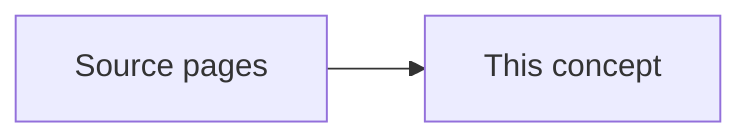

# Area-Based Approach

Existing concept literature-map-dense-itd covers individual tree detection workflows, leaving the standard plot- and grid-level statistical modeling of forest structural attributes (ABA) unrepresented.

This page names the shared idea. It does not open an experiment folder. [[project/domains]] does not gain a new program from this page.

## What the sources describe

- [[sources/paper-flygburen laserskanning för skogliga skattningar-faktaskog_04_2014]] — SLU review of area-based and individual tree detection (ITD) methods from airborne laser scanning (ALS) for Swedish forest inventory.
- [[sources/paper-skoglig fjärranalys-ljungbergs_sv_20180824]] — Foundational Swedish textbook compendium covering physics, sensor platforms, photogrammetry, laser scanning, and remote sensing methods for forestry.
- [[sources/paper-skattningar i gallringsskog med hjälp av flygburen laserskanning -beräkningar med massaslutenhet]] — SLU thesis investigating area-based estimation of volume density (massaslutenhet), height, basal area, and stem volume from low-pulse ALS for thinning prioritization.

Stand dominant height, site index, and stand volume stay on [[concepts/site-index-and-yield]].

## Replication notes

Coefficients stay on the source pages. Nothing here is implemented in the detection pipeline.

| Paper | Our status |
|---|---|
| [[sources/paper-flygburen laserskanning för skogliga skattningar-faktaskog_04_2014]] — Flygburen laserskanning för skogliga skattningar | TBD |
| [[sources/paper-skoglig fjärranalys-ljungbergs_sv_20180824]] — Skoglig Fjärranalys (Forest Remote Sensing) | TBD |
| [[sources/paper-skattningar i gallringsskog med hjälp av flygburen laserskanning -beräkningar med massaslutenhet]] — Airborne laser scanning data estimates for forests that are candidates for thinning cuttings - calculations of volume density | TBD |

## Related

- [[concepts/site-index-and-yield]] — stand site index and stand volume
- [[concepts/crown-ownership]] — a crown box is not yet a measured crown width
- [[concepts/canopy-height-model]] — tree height read from the canopy surface
- [[project/domains]] — allometry program not started
