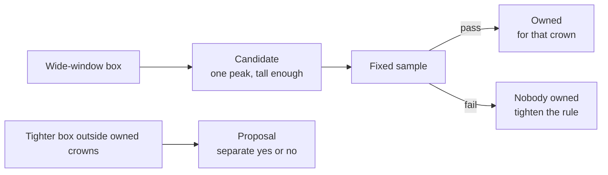

# Crown ownership

Procedure for the candidate rule in [[project/research-normal-forest]] and the smoke in [[experiments/normal-forest/exp-005-normal-forest-ownership-smoke]]. This page does not fuse detection layers. Fusion of layers stays on [[experiments/r-class-itd/exp-003-merge-fusion-v1]], which is parked.

## Executive summary (for the board)

A wide-window box can stand for one crown when a single treetop sits in the middle of that box and the tree height is at least 7 m. Tree height is the peak's Z. People check a fixed sample of those boxes. They do not draw the stand, and they do not sign every crown. If the sample passes the signed bar, the same rule owns the other crowns it marked. A tighter-window box outside those crowns is a separate proposal. A language model does not create or delete those boxes.

The verdict list, the precision formula, and the 20 by 150 cap are the ones in [[concepts/pseudo-label-audit-cvat]]. This page does not replace that manual.

#### Takeaway

Ownership is a rule plus a sample. It is not a second drawing of the forest, and it is not a blend of every detector.

## Three statuses

#### For the board

Three labels only. A candidate is waiting on the sample. An owned box is ground truth for the crown it marks, after that sample passes. A proposal is a tighter box sitting outside every owned crown, and it never inherits the owned status.

| Status | Rule | Human work |
|--------|------|------------|
| Ownership candidate | SAHI 800 box, one local-maxima peak in the box core, tree height above 7 m | Fixed sample, not every box |
| Owned / ground truth for that crown | Same frozen rule after the sample passes | None on that box |
| Proposal | SAHI 400 box whose center is outside every owned box | Yes/no sample |

The core is the central half of the box: from `(x + 0.25w, y + 0.25h)`, size `0.5w` by `0.5h`. One peak only. Two peaks inside one 800 box means the box is not a candidate.

Tree height is at least 7 m. That number is the local-maxima peak's Z. A CHM detection is a mark drawn on the CHM raster, and it is not this measurement.

#### Takeaway

One peak in the middle, and tall enough. Two peaks in one wide box, and that box is not a candidate.

## Witnesses

#### For the board

The treetop and the tree height are what make a box a candidate. A CHM detection is a mark drawn on the CHM raster. On the small-tree pilot those marks, at the 100 px slice, put several hits on one crown. A vision-language model may point at a box the photo model already drew, so a person looks at it. Agreement from that model is not required. A box that only the language model drew is never owned. If the language model draws nothing, the detector box stays.

- Primary witness: one local-maxima peak in the core, and tree height above 7 m. Tree height is the peak's Z.
- A CHM detection is not a witness. That includes CHM detections at slice 100 px. On the R-class pilot they put several marks on one crown ([[experiments/r-class-itd/exp-004-rgb-small-student-pseudo-v2]]).
- A VLM may raise a detector box in the review queue. VLM agreement is not required for ownership.
- A VLM-only box is never owned. A missing VLM box does not delete a detector box.

#### Takeaway

Peaks and height witness the photo box. The language model can only ask for a second look.

## Human sample

#### For the board

People review a capped sample of candidates, using the same yes / no / wrong-size answers as the earlier label check. They do not hunt for trees that have no box. The pass bar is signed: precision ≥ 0.85 and agreement ≥ 0.80. The precision gate is the lower end of the interval.

Reuse [[concepts/pseudo-label-audit-cvat]] for the verdict mechanics. Do not copy a second CVAT manual here.

- Sample up to 20 tiles and 150 candidates. Ten tiles from the high half of peak counts, ten from the low half. Thirty boxes read by a second person.
- Verdicts: accept, reject, `accept_resize`. `unset` must be 0.
- `precision = accept / (accept + reject + accept_resize)`.
- Agreement = same verdict / 30. Under 80%, the sample does not count. Add picture examples and re-read those 30. Do not grow the sample to dilute disagreement.
- Signed bar: precision ≥ 0.85 and agreement ≥ 0.80. On 150 boxes the lower end reaches 0.85 only at 137 hits. A raw 0.85 does not pass.

#### Takeaway

Twenty tiles, about 150 boxes, thirty read twice. If the two readers disagree, fix the pictures and re-read those thirty. Do not add boxes to hide the disagreement.

## Pass and fail

#### For the board

The first look is still 20 images and about 150 boxes. A clean sample does not by itself sign every box nobody opened. Unread boxes become labels only on one of two paths. A small set is at most 300 candidates. The wider sample stops after 600 candidate boxes. The precision bar is signed at 0.85. Otherwise those boxes stay candidates. Boxes in the sample that were rejected, or marked the wrong size, come out on either path. One frozen rule covers the whole candidate set. The pool is not split into batches that each pass or fail on their own.

1. **Small set.** The 150-box sample may promote the unread candidates only when the candidate count is at most 300. Then 150 is at least half the pool. A pool of 10,000 candidates is an illustration that 150 is not a large share (1.5%). Do not use 10,000 as a threshold. Stand 17568, with 6047 one-peak boxes, is not a small set.
2. **Same rule, wider sample.** The gate is the lower end of a 95% Wilson interval on the sample, compared with the signed precision bar of 0.85. A raw fraction of 0.85 on 150 boxes does not by itself promote unread boxes. If that lower end is still under the bar, draw another sample from the same frozen rule and the same pool. Do not tighten the rule yet. Tightening — peak closer to the center, or a higher tree height — starts only after 600 candidate boxes, and the lower end is still under the bar. About 1200 reads is the arithmetic for a ±2 point interval around 0.85. It is not the cap. The thirty second reads in each sample count toward agreement, not toward the 600. After that cap, nobody is owned. The boxes stay on disk. Draw a new sample only after the rule is tighter. Do not re-label the same boxes until the fraction looks better.

These figures illustrate width. They are not a signed sample size and not a pass mark. A raw 128/150 (0.853) clears a 0.85 point estimate, while the lower end of a 95% Wilson interval on that result is about 0.79. That lower end reaches about 0.85 only near 137/150. About 1200 reads is the arithmetic for a ±2 point interval around 0.85. It is not the cap. The cap is 600 candidate boxes.

Agreement is separate. Under 80% on the 30 double-read boxes, the sample does not count. Add picture examples and re-read those 30. Do not grow the sample to dilute disagreement. A wide interval is not an agreement failure.

- **Pass:** unread candidates become owned only by path 1 or path 2, except sample rejects and `accept_resize`. People do not sign each crown.
- **Otherwise:** unread candidates stay candidates.
- **Fail of path 2 after 600 candidate boxes:** nobody is owned. Tighten the rule, then draw a new sample.
- This number is precision of the rule. It does not measure missed crowns. Reviewers do not hunt for trees with no box.
- After a pass, an owned box needs no second witness. On `tile_03`, five visible crowns have no owned box from either window. They are not added as labels. Gaps that are not those five crowns can be background on that window. The mark is on [[experiments/normal-forest/exp-005-normal-forest-ownership-smoke]].
- Proposals never inherit this status. Their own sample was read on 2026-11-04 and is on [[project/normal-forest-flow]]: precision 0.967, Wilson lower end 0.924, agreement 0.867. Unread boxes on that list become labels. Five wrong-size boxes stay out, leaving 2719.

#### Takeaway

About 150 boxes sign the unread ones only when the set is small, or when the lower end of the interval reaches the signed bar. Otherwise those boxes stay candidates.

## Related

- [[project/research-normal-forest]]
- [[concepts/normal-forest]]
- [[concepts/pseudo-label-audit-cvat]]
- [[experiments/normal-forest/exp-005-normal-forest-ownership-smoke]]
- [[experiments/r-class-itd/exp-004-rgb-small-student-pseudo-v2]]
- [[experiments/r-class-itd/exp-002-rgb-seg-backend-ceiling]]
- [[methods/deimv2-canopy]]
- [[methods/local-maxima]]
- [[methods/chm-detection]]
- [[concepts/canopy-height-model]]
- [[project/decisions]] — ADR-003 (proposed)

## Open questions from literature

- How should crown ownership rules handle leaning trees whose canopy peak falls entirely inside an adjacent tree's detection bounding box?
