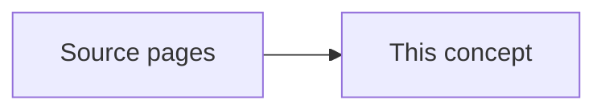

# Foundation Model Prompting for Tree Delineation

Existing concepts literature-map-dense-itd and dense-stand-detection focus on conventional CNN/watershed/NMS detection pipelines rather than zero-shot/few-shot prompting workflows leveraging vision foundation models (SAM/SAM2/DINOv2/v3) for crown delineation.

This page names the shared idea. It does not open an experiment folder. [[project/domains]] does not gain a new program from this page.

## What the sources describe

- [[sources/paper-treepseco_scaling_individual_tree_crown_segmentation_using_large_vision_models-isprs-archives-xlviii-m-7-2025-275-2025]] — Adapts the PseCo framework using Segment Anything Model (SAM) and Faster R-CNN for robust individual tree crown segmentation in aerial imagery.
- [[sources/paper-zero-shot_tree_detection_and_segmentation_from_aerial_forest_imagery-2506-03114v1]] — Evaluates Segment Anything Model 2 (SAM2) in a zero-shot manner and via bounding box prompting from DeepForest for individual tree crown delineation.
- [[sources/paper-fsod-vfm]] — A training-free few-shot object detection framework integrating UPN, SAM2, and DINOv2/v3 with a graph diffusion-based confidence reweighting mechanism to eliminate proposal overfragmentation.

Stand dominant height, site index, and stand volume stay on [[concepts/site-index-and-yield]].

## Replication notes

Coefficients stay on the source pages. Nothing here is implemented in the detection pipeline.

| Paper | Our status |
|---|---|
| [[sources/paper-treepseco_scaling_individual_tree_crown_segmentation_using_large_vision_models-isprs-archives-xlviii-m-7-2025-275-2025]] — TreePseCo: Scaling Individual Tree Crown Segmentation using Large Vision Models | TBD |
| [[sources/paper-zero-shot_tree_detection_and_segmentation_from_aerial_forest_imagery-2506-03114v1]] — Zero-Shot Tree Detection and Segmentation from Aerial Forest Imagery | TBD |
| [[sources/paper-fsod-vfm]] — FSOD-VFM: Few-Shot Object Detection with Vision Foundation Models and Graph Diffusion | TBD |

## Related

- [[concepts/site-index-and-yield]] — stand site index and stand volume
- [[concepts/crown-ownership]] — a crown box is not yet a measured crown width
- [[concepts/canopy-height-model]] — tree height read from the canopy surface
- [[project/domains]] — allometry program not started
