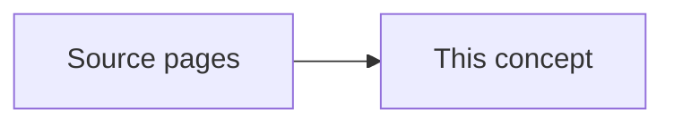

# Height-Diameter and Crown-Diameter Inversion

Existing concept tree-allometry covers forward scaling of DBH to volume/crown metrics, whereas remote sensing inventory relies on inverted allometric formulations predicting DBH from height, crown width, and stand density.

This page names the shared idea. It does not open an experiment folder. [[project/domains]] does not gain a new program from this page.

## What the sources describe

- [[sources/paper-dbh vs height 1-s2-0-s0378112725008801-main]] — Inverted allometric model predicting tree DBH from height and Reineke-based stand relative density across six temperate tree species.
- [[sources/paper-prediction of diameter using height and crown attributes - filipescu_etal2012wjafdbh_ht_model]] — Nonlinear mixed-effects models predicting DBH from tree height, crown area, and crown area of larger trees across three conifer species.
- [[sources/paper-robust height-diameter allometries for 41 european tree species - stand characteristics and structure matter-2025-09-29-679156v2_full]] — Generalized nonlinear mixed-effects H-D allometric models for 41 European species incorporating stand structure, basal area, and quadratic mean diameter, with a 1-to-6 tree local recalibration routine.

Stand dominant height, site index, and stand volume stay on [[concepts/site-index-and-yield]].

## Replication notes

Coefficients stay on the source pages. Nothing here is implemented in the detection pipeline.

| Paper | Our status |
|---|---|
| [[sources/paper-dbh vs height 1-s2-0-s0378112725008801-main]] — Species-specific modeling of tree diameter at breast height using tree height and relative density with implications for remote sensing-based forest inventory | TBD |
| [[sources/paper-prediction of diameter using height and crown attributes - filipescu_etal2012wjafdbh_ht_model]] — Prediction of Diameter Using Height and Crown Attributes: A Case Study | TBD |
| [[sources/paper-robust height-diameter allometries for 41 european tree species - stand characteristics and structure matter-2025-09-29-679156v2_full]] — Robust height-diameter allometries for 41 European tree species: stand characteristics and structure matter | TBD |
| Näslund height inversion (Douglas fir vs Norway spruce) | TBD |
| Projected crown area DBH inversion (power vs linear scaling) | TBD |
| Site-fertility stratification for spruce allometry | TBD |

Pseudocode: [[sources/paper-tree allometry of douglas fir and norway spruce on a nutrient-poor and a nutrient-rich site_urban_dg_2012#Replication pseudocode]].
## Related

- [[concepts/site-index-and-yield]] — stand site index and stand volume
- [[concepts/crown-ownership]] — a crown box is not yet a measured crown width
- [[concepts/canopy-height-model]] — tree height read from the canopy surface
- [[project/domains]] — allometry program not started

## Open questions from literature

- Can crown projection area or crown width extracted from UAV orthophotos reliably substitute for DBH when coupled with Heiðarsson's height exponent for Icelandic Sitka plantations?
- How sensitive are Laasasenaho volume predictions to systematic photogrammetric canopy height underestimations when combined with inverted crown-diameter DBH models?
- Can the forward 4-parameter q-exponential formulation be inverted numerically or analytically with stable gradient behavior for Scots pine across Baltic inventory plots?
- Can species classification and soil trophic priors be combined to dynamically select between linear and power-law crown-to-DBH inversion models?