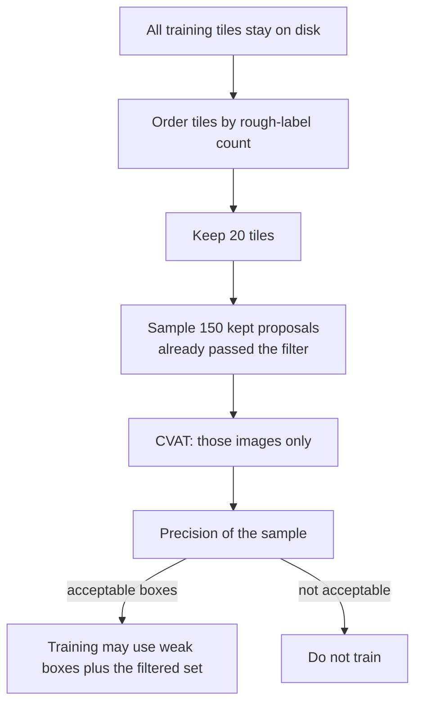
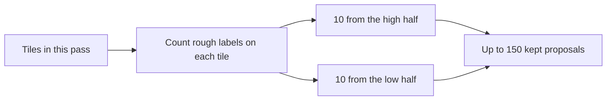
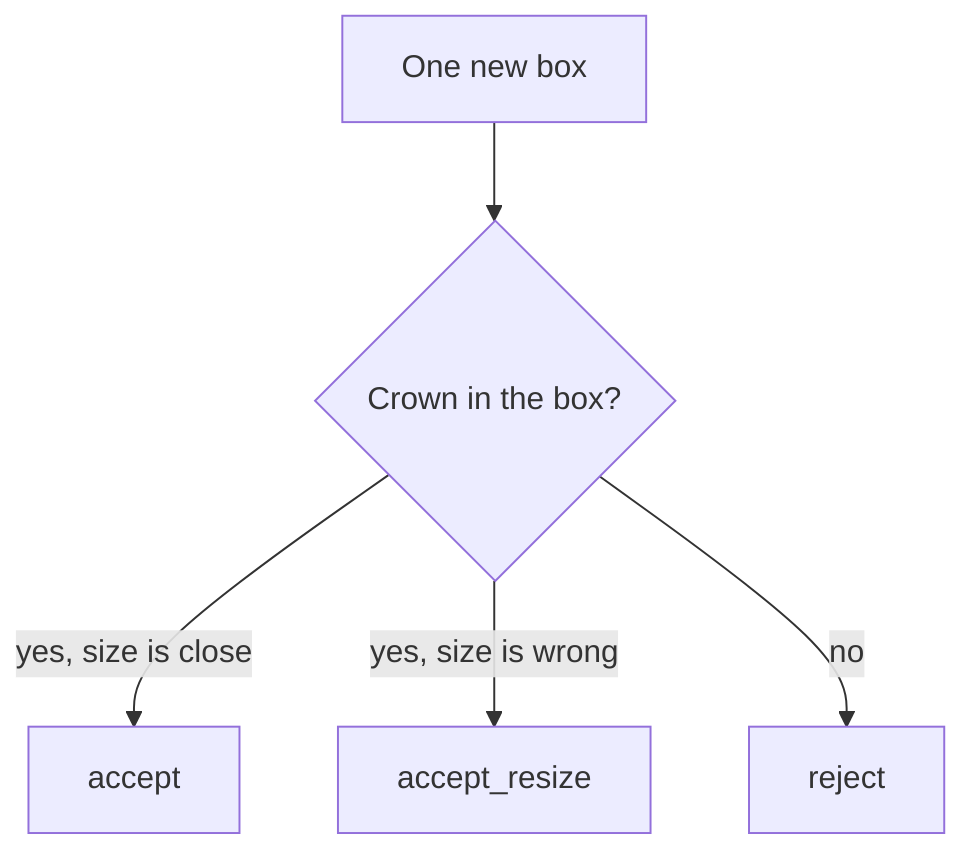

# Pseudo-label audit in CVAT

Procedure for the human gate in [[experiments/exp-004-rgb-small-student-pseudo-v2]] Phase A. People judge a **fixed sample of new boxes**. They do not redraw the training forest.

## Executive summary (for the board)

Before the next training run, a person checks whether the **extra boxes** the current model wants to add are real trees. The check is a **sample**, not a pass over every forest area we train on.

The **first** check uses **one area only** (AREA **540**, the small smoke-test region from exp-001). That proves the annotation workflow. It does **not** by itself approve a new model. The sample that gates training is a later, still capped, draw from the wider training areas.

We do **not** upload the full training set to the annotation tool. We do **not** draw “dense” and “sparse” zones by eye, and we do not build a new segmentation model to pick tiles. Tiles are ordered by **how many rough labels they already have**.

The person does **not** count “about ten trees are missing here.” Each reviewed box is yes, no, or “real tree but the box is the wrong size.”



## What this audit is

#### For the board

One question: **of the boxes the filter already kept, what fraction are acceptable?** Acceptable means a real crown and a usable box. A real tree with a bad box (`accept_resize`) counts as a failure. That fraction is the written precision. It is the gate. It is not a new map of the stand.

#### Takeaway

Audit = precision of **kept proposals** (tree and box size). Not a second golden dataset. The sample does not remove the other kept proposals from training.

## What is out of scope

- Uploading every training AREA, orthophoto, or tile to CVAT
- Asking reviewers to find unlabeled trees (“missing 10 here”)
- Editing or deleting existing weak labels
- Drawing new boxes for the rest of the training set
- Using [[experiments/exp-001-per-layer-baselines]] hold-out `kaxen_197_1` or weak test AREA **481** as audit or train material
- Requiring a human accept on every box that will be used in fine-tune
- Choosing dense vs sparse tiles by looking at the map
- Training a segmentation model, or a local-maxima height filter, **only** to pick the audit sample
- Treating the AREA 540 pilot as the exp-004 success training set (smoke FT on 540 already failed to close small-tree recall on golden)

## Two passes

| Pass | Where | Role |
|------|--------|------|
| **A0-pilot** | AREA **540** only (exp-001 smoke weak GT) | Prove CVAT, attributes, export, and that two people share the criteria. Caps shrink if 540 has fewer than 20 tiles or fewer than 150 new boxes — record the shortfall. |
| **A0** | Round 1 train AREAs (not 540-only, not hold-out) | The precision number that can unlock fine-tune. Sample caps below. |

A passing pilot means the **procedure** works. It does not mean the student may be trained on 540 alone and compared to Round 1 as the exp-004 gate.

**2026-10-16.** The AREA 540 pack under review is `research/exp-004/results/a0_pilot_540/svk800_gap_core`. Context boxes are the full `svk_full` SAHI 800 crowns. New boxes are the kept Round 1 proposals (SAHI 400 confirmed at 200, center outside the 800-box core). Each pack is its own task. The reviewer still only sets the verdict. This sample does not open A0.

## Sample caps (locked for pass A0)

These caps exist so the job cannot grow with stand density. The pilot may be smaller. Change the A0 caps only by editing this page before that task is created.

| Cap | Value | Why |
|-----|------:|-----|
| Tiles in CVAT | **20** | Bounds upload and reviewer load |
| New boxes reviewed | **150** | Precision estimate; not full coverage |
| Higher vs lower label-count tiles | **10 + 10** | Dense-looking tiles are in the sample without opening every one |
| Double-read overlap | **30** boxes | Two people, same boxes, agreement check |
| Time box | **one sitting per person** | ~10 s per box → about half an hour for 150, plus overlap |

**Go / no-go percentage** (how high precision must be to allow training) is still **TBD**, as is the separate bar for how far the trained model must beat Round 1. Agree **both** before the A0 CVAT task is opened. Do not pick them after seeing the labels. The pilot does not need those bars; it needs a completed export and an agreement figure.

## How tiles are ordered (not by eye)

On the tiles in scope, count **existing weak boxes per tile**. Sort by that count. Take 10 from the top half and 10 from the bottom half (or all of a half, if it is shorter, and record the shortfall).

That count is the density proxy. If a local-maxima layer **already exists** on those tiles, its point count per tile may replace the weak-box count. Do not create that layer for this audit. Do not filter peaks by crown size or height to choose tiles — that filter belongs later, as an optional teacher rule, not as sample design.



## How the sample is built (before CVAT)

Work on **training tiles** already used for the detector (the sliced images), not on a full-area orthophoto. A single huge ortho is a CVAT performance risk and is out of scope.

```text
1. Choose the pass:
   - A0-pilot: AREA 540 tiles only.
   - A0: AREAs 473–479 only. Drop val 480, test 481, and golden kaxen_197_1. Do not use AREA 540.
2. Mark proposals that the first-pass filter already kept for train COCO (Round 1 FT @400 with no weak-GT match at IoU 0.5, confirmed by a @200 box at IoU ≥ 0.5). On the AREA 540 pilot, use the same rule on 540 tiles only.
3. Rank tiles by weak-label count (or existing LM count — see above).
4. Draw 10 tiles from the top half and 10 from the bottom half.
   If a half has fewer than 10 tiles with at least one kept proposal, take all of them and record the shortfall.
5. Inside those tiles, sample up to 150 kept proposals. Do not ask a person to draw them.
   Sample from the same pool that enters train COCO. Do not overweight small boxes or low confidence.
   Record the small-box share and the low-confidence share in the task notes.
6. If a selected tile has more new boxes than the sample needs, leave the extras out of CVAT.
   They may still enter training later; they are not human-labelled.
7. Build one COCO json for the selected images:
   - category context_weak = existing weak boxes on those images (context only)
   - category proposal_new = the sampled new boxes only
8. Copy only those image files into the CVAT import folder.
```

Density in the forest increases how many proposals exist **on disk**. It does not increase how many images or boxes enter CVAT.

## CVAT setup

One project, one task per pass, labels created **before** import.

### Project and labels

1. Create a project named `exp-004-pseudo-v2-audit` (add `-540` on the pilot task).
2. Add labels:

| Label | Shape | Who edits | Meaning |
|-------|--------|-----------|---------|
| `context_weak` | rectangle | nobody (locked) | Existing weak box, context only |
| `proposal_new` | rectangle | attribute only | New box under review |

3. On `proposal_new` add a required attribute `audit`:

| Value | Meaning |
|-------|---------|
| `unset` | Default at import. Not a finished review. |
| `accept` | Center lies on a visible crown and the box covers mainly that crown. Mild size error is allowed. |
| `reject` | Empty, shadow, road, duplicate of a `context_weak` box, two crowns in one box, or the box sits clearly beside the crown. |
| `accept_resize` | A real crown is there, but the box is the wrong size (clipped or far too large). Do not “fix” it in this task. |

4. Optional attribute `reject_reason` on `proposal_new`: `empty` / `duplicate` / `merged` / `offset` / `other`. Use it when `audit=reject`. Skip it on accept.

### Task import

1. Create a task in that project. Upload **only the sampled tile images**.
2. Import the audit COCO (or convert COCO → CVAT XML if your CVAT build has no COCO import). After import, counts must match the sample manifest.
3. Select all `context_weak` shapes and **lock** them. Reviewers must not move, delete, or add context boxes.
4. Lock `proposal_new` **geometry** as well if the UI allows per-shape lock after import. The job is the attribute, not a new drawing. If geometry lock is unavailable, the written rule is: do not add, delete, or reshape rectangles.
5. Split into two jobs only if two people work in parallel. Overlap is **the same 30 `proposal_new` ids** in both jobs (or all of them, if the pilot has fewer than 30), listed in the manifest, not “whatever each person happens to open.”
6. Assign jobs. Tell reviewers the attribute list and three picture examples of accept / reject / accept_resize (attach to the task description).

### What the reviewer does

1. Open the job. Turn on both labels. `context_weak` is gray context. `proposal_new` is the object to judge.
2. Use the shape list or filters so each `proposal_new` is visited once. Do not hunt the image for crowns that have no box.
3. For each `proposal_new`, set `audit`. If reject, set `reject_reason`.
4. Leave `unset` at zero before you finish. A box still `unset` is an unfinished task, not a reject.
5. Do not create new rectangles. A crown with no proposal is **invisible to this audit** on purpose.



### Export and score

1. Export the task (CVAT for images 1.1 or COCO — keep attributes).
2. Join on `proposal_new` id to the manifest.
3. Primary reviewer precision:

```text
precision = accept / (accept + reject + accept_resize)
```

`accept_resize` counts as a geometry failure, not a hit. `unset` must be 0.

4. On the overlap boxes, agreement = same `audit` value from both people / overlap count. If agreement is under **80%**, the criteria are unclear: do not train, add picture examples, and re-read the overlap. Do not expand the sample to “solve” disagreement.
5. Write on the exp-004 page: pass id (pilot or A0), n, precision, agreement, reject_reason counts, and precision on the high-count half vs the low-count half. For A0, compare precision to the pre-agreed bar.

## After the audit

| Result | Next step |
|--------|-----------|
| Pilot finished, agreement ≥ 80% | Open A0 on the Round 1 train pool. Do not start fine-tune on 540 alone. |
| A0 precision at or above the pre-agreed bar, agreement ≥ 80% | Fine-tune may start on the **machine-filtered** pseudo set from the wide train pool, not “only boxes a human accepted,” and not 540-only. |
| A0 precision below the bar | Do not train. Tighten the teacher filter (confidence, or the 400-and-200 rule) and sample a **new** 20×150 from the kept proposals. |
| High-count tiles much worse than the low-count half | Change the filter for high-count tiles and re-sample. Do not open the rest of those areas in CVAT. |
| Fewer new boxes than the cap | Review all of them, record the shortfall, and treat “teacher added almost nothing” as a teacher problem, not a reason to search for misses by hand. |

## Board checklist

- [ ] Pilot task is AREA 540 only and is labeled as a procedure check
- [ ] A0 precision bar **and** the Round 1 beat margin (both metrics, plus precision floor) written down **before** the A0 CVAT import
- [ ] A0 package is 20 tiles / 150 new boxes (or a recorded shortfall)
- [ ] Tile halves come from weak-box counts, not from a hand-drawn density map
- [ ] Hold-out images are absent from the task
- [ ] Full training set was **not** uploaded
- [ ] Export has zero `unset`
- [ ] Overlap agreement recorded
- [ ] exp-004 Phase B stays blocked until the A0 row of this checklist is signed

## Related

- [[experiments/exp-004-rgb-small-student-pseudo-v2]]
- [[experiments/exp-001-per-layer-baselines]]
- [[project/research-tree-detection-ensemble]]
- [[methods/local-maxima]]
