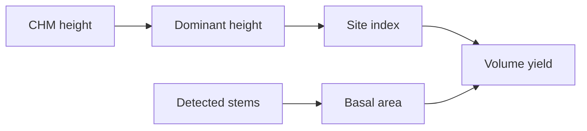

# Site index and stand yield

Site index is the dominant height a stand is expected to reach at a reference age. Stand yield is the volume that height, together with basal area, implies. Both are stand-level numbers. They sit downstream of a canopy height model and a stem count. They are not a detector.

The allometry row in [[project/domains]] is still not a started program. This page names the shared idea. It does not open an experiment folder.

## Dominant height, not mean height

Field site index uses the height of the largest trees, not the mean of every stem. [[sources/paper-mean_height_or_dominant_height_–_what_to_prefer_for_modelling_the_site_index_of_estonian_forests]] defines dominant height as the mean height of the 100 thickest trees per hectare. Thinning from below raises mean height because small stems leave the average. The same paper finds that change in dominant height after that thinning is not statistically significant. A canopy height model already sees the top of the canopy, so a high percentile of [[concepts/canopy-height-model]] is the remote-sensing cousin of that dominant height, not of mean height.

[[sources/paper-site index models for main forest-forming tree species in poland_forests-11-00301]] fits dominant-height curves for eight Polish species. The reference age in that replication is 100 years. The curves are GADA forms (generalized algebraic difference equations). GADA is the fitting family on that source page. It does not need its own concept page.

[[sources/paper-appiahmensah_et_al_2023_site_index_sis_rs]] maps Swedish site index for Scots pine and Norway spruce from airborne laser scanning: height percentiles and the change in the 95th percentile between two scans, plus terrain. There, site index is the expected dominant height at age 100. Which CHM percentile matches a field dominant height on our stands is still open.

## Volume needs basal area as well as height

[[sources/paper-appiahmensah_et _al-2022_yield capacity]] defines yield capacity as the maximum mean annual volume increment. Predicting stand volume from dominant height alone (Eichhorn's rule) leaves a site-dependent error. Adding basal area, $V = \alpha_0 H^{\alpha_1} G^{\alpha_2}$, cuts that error. The same paper then relates site index to yield capacity with an exponential curve. Coefficients are species-specific, so a species label from [[methods/dinov3-classification]] has to choose the set. Eichhorn's rule stays a claim on that source page.

[[sources/paper-evaluation of growth functions used in the swedish forest planning system heureka_article1013]] compares stand-level and single-tree basal-area growth in the Swedish Heureka system. One stand-level model was more precise for total growth than the detailed tree-level models. Heureka uses the tree-level functions to spread growth across diameters and the stand-level function to set the total. That system is one paper. The useful idea here is the split: detected trees can describe the distribution, and a stand total keeps the sum from drifting.

## Tree-level stems

Measuring diameter, lean, and stem volume on a single tree is a different job. [[sources/paper-extraction_of_individual_tree_attributes_using_ultra-high-density_point_clouds_acquired_by_low-cost uav-lidar_in_eucalyptus_plantations]] does that for plantation eucalyptus with very dense UAV lidar. Tree-level crown width, DBH, height, and stem volume are [[concepts/tree-allometry]]. This page stays with stand site index and stand volume.

## Replication notes

Equations and fitted coefficients stay on the source pages. Nothing here is implemented in the detection pipeline.

| Paper step | Our status |
|---|---|
| [[sources/paper-site index models for main forest-forming tree species in poland_forests-11-00301#Replication pseudocode]] — dominant height at base age 100 from a measured top height and age | TBD |
| [[sources/paper-appiahmensah_et_al_2023_site_index_sis_rs#Replication pseudocode]] — site index from two lidar scans' height percentiles | TBD |
| [[sources/paper-mean_height_or_dominant_height_–_what_to_prefer_for_modelling_the_site_index_of_estonian_forests#Replication pseudocode]] — dominant height versus mean height under thinning | TBD |
| [[sources/paper-appiahmensah_et _al-2022_yield capacity#Replication pseudocode]] — volume from top height and basal area, then yield capacity from site index | TBD |
| [[sources/paper-evaluation of growth functions used in the swedish forest planning system heureka_article1013#Replication pseudocode]] — stand basal-area growth as a check on a tree-level sum | TBD |

## Open questions from literature

- What CHM height percentile best approximates the field dominant height $H_{100}$ used by [[sources/paper-appiahmensah_et _al-2022_yield capacity]]? The 95th versus 99th percentile of detected crowns per hectare is unresolved.
- Can stand top height from a photogrammetric or lidar CHM constrain site index and basal-area increment so that summing detected crowns does not drift ([[sources/paper-evaluation of growth functions used in the swedish forest planning system heureka_article1013]], [[sources/paper-appiahmensah_et_al_2023_site_index_sis_rs]])?
- Can the Estonian dominant-height regression be inverted to recover registry mean height from a UAV top height and a stem count ([[sources/paper-mean_height_or_dominant_height_–_what_to_prefer_for_modelling_the_site_index_of_estonian_forests]])?
- Can the Polish GADA height curves, run backwards from a CHM dominant height, bound stand age and expected crown size during segmentation ([[sources/paper-site index models for main forest-forming tree species in poland_forests-11-00301]])?
- Can the invariant $0.3 \times H$ height rule and linear DBH-$D_M$ taper relationship from Vasilescu et al. (2017) be reliably combined with drone-derived CHM heights and crown-allometry DBH estimates to compute individual stem volume in mature spruce stands?
- Can stand-level volume density (Jonsson 1914) serve as an area-level conservation constraint to bound total basal area and stem density when individual crown detection degrades in dense young stands?
## Related

- [[concepts/canopy-height-model]] — height surface these numbers read from
- [[concepts/normal-forest]] — merchantable stands where dominant height is the usual field definition
- [[methods/local-maxima]] — treetops that can supply a top-height sample
- [[methods/dinov3-classification]] — species label that selects yield coefficients
- [[concepts/tree-allometry]] — tree-level crown, DBH, and stem
- [[project/domains]] — allometry program not started
