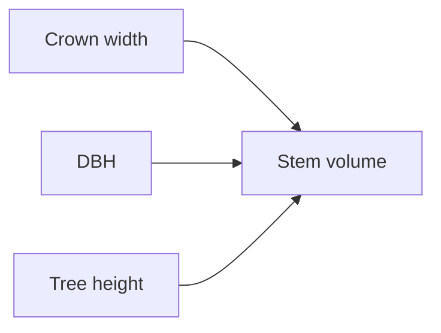

# Tree-Level Allometric Scaling

Existing concept site-index-and-yield explicitly restricts coverage to stand-level site index, dominant height, basal area, and yield capacity, leaving individual tree DBH, crown width, crown base height, and stem volume relationships unrepresented.

This page names the shared idea. It does not open an experiment folder. [[project/domains]] does not gain a new program from this page.

## What the sources describe

- [[sources/paper-a crown width-diameter model for natural even-aged black pine forest management-forests-09-00610-v2]] — Nonlinear fixed and mixed-effects crown width models for Pinus nigra using DBH, competition metrics, and variance modeling.
- [[sources/paper-a rapid method for estimating the median diameter of the stem profile of norway spruce trees-iforest_ifor1945-009_vasilescu]] — Presents empirical models demonstrating that the median diameter of the longitudinal stem profile in Norway spruce occurs at ~0.3 × height and is strongly predicted by DBH.
- [[sources/paper-a_linkage_among_tree_diameter_height_crown_base_he]] — Vasicek-type 4-variate stochastic differential equation framework modeling Scots pine DBH, height, crown base height, and crown width dynamics over stand age.
- [[sources/paper-alder_allometry_cpi023]] — Empirical stem volume models, basic wood density, and stand yield relationships for Alnus incana and Alnus glutinosa across Sweden.
- [[sources/paper-allometric relationships of selected european tree-gp_eudor_pdfa1b_euna20855enc_001]] — Compendium of allometric equations for crown radius, tree height, crown base height, LAI, and biomass for five European commercial species (birch, beech, larch, Norway spruce, Scots pine).

Stand dominant height, site index, and stand volume stay on [[concepts/site-index-and-yield]].

## Replication notes

Coefficients stay on the source pages. Nothing here is implemented in the detection pipeline.

| Paper | Our status |
|---|---|
| [[sources/paper-a crown width-diameter model for natural even-aged black pine forest management-forests-09-00610-v2]] — A Crown Width-Diameter Model for Natural Even-Aged Black Pine Forest Management | TBD |
| [[sources/paper-a rapid method for estimating the median diameter of the stem profile of norway spruce trees-iforest_ifor1945-009_vasilescu]] — A rapid method for estimating the median diameter of the stem profile of Norway spruce (Picea abies Karst) trees | TBD |
| [[sources/paper-a_linkage_among_tree_diameter_height_crown_base_he]] — A Linkage among Tree Diameter, Height, Crown Base Height, and Crown Width 4-Variate Distribution and Their Growth Models: A 4-Variate Diffusion Process Approach | TBD |
| [[sources/paper-alder_allometry_cpi023]] — Stem volume equations and basic density for grey alder and common alder in Sweden | TBD |
| [[sources/paper-allometric relationships of selected european tree-gp_eudor_pdfa1b_euna20855enc_001]] — Allometric Relationships of Selected European Tree Species | TBD |
| Extract individual tree height from remote sensing CHM | aligned |
| Attribute species via tree-crown classifier | aligned |
| Compute local stand stem density and relative density (RD) | TBD |
| Predict tree DBH via species-specific power law (H, RD) | TBD |
| Shortened stem volume calculation from DBH and height | aligned |
| Complete stem volume calculation incorporating crown ratio and bark thickness | TBD |
| Brandel stem volume calculation from species, DBH, height, and regional zone | TBD |
| Piecewise Gaussian DBH-to-crown diameter prediction (x <= 28 cm, 28 < x <= 52 cm) | not used |
| Lookup species mappings to crown and root biomass groups (Tables 6 & 7) | not used |
| Evaluate piecewise DBH crown biomass (<7 cm AGB power, 7-50 cm crown power, >50 cm linear) | not used |
| Evaluate piecewise DBH root biomass (<=30 cm power exp 2.5, >30 cm linear) | not used |
| Hossfeld II H-D parameter estimation per species | not used |
| Inverted H-to-DBH estimation with BA and Dg | TBD |
| Plot random site parameter recalibration (3-4 sample trees) | TBD |
| Fit weighted non-linear regression $Y = a \cdot DBH^b \cdot H^c$ with inverse prediction weighting ($w_i = 1 / \hat{y}_i$) | not used |
| Evaluate species pooling via dummy indicator variables (significant for volume, non-significant for biomass) | not used |
| Select species parameter set (pine, spruce, birch) | not used |
| Log-linear stem volume estimation from d and h with bias correction | not used |
| Fibonacci polynomial relative taper curve evaluation across relative height | not used |

Pseudocode: [[sources/paper-taper curve and volume functions for pine, spruce and birch-951-40-0589-9#Replication pseudocode]].

Pseudocode: [[sources/paper-sitka_spruce ias-2023-6-l-heidarsson-k-nystrom-a-snorrason-69-80#Replication pseudocode]].

Pseudocode: [[sources/paper-robust height-diameter allometries for 41 european tree species - stand characteristics and structure matter-2025-09-29-679156v2_full#Replication pseudocode]].

Pseudocode: [[sources/paper-revised-biomass-equations-27jan2014#Replication pseudocode]].

Pseudocode: [[sources/paper-pine crown and trunk diameter dependence research-27_short_paper#Replication pseudocode]].

Pseudocode: [[sources/paper-nya volymfunktioner för tall, gran och björk-brandel#Replication pseudocode]].

Pseudocode: [[sources/paper-funktioner och tabeller för kubering av staende träd-medd_statens_skogsforskningsinst_036_03#Replication pseudocode]].

Pseudocode: [[sources/paper-dbh vs height 1-s2-0-s0378112725008801-main#Replication pseudocode]].
## Related

- [[concepts/site-index-and-yield]] — stand site index and stand volume
- [[concepts/crown-ownership]] — a crown box is not yet a measured crown width
- [[concepts/canopy-height-model]] — tree height read from the canopy surface
- [[project/domains]] — allometry program not started

## Open questions from literature

- How can stand relative density (RD) or mean plot diameter be initialized without circular dependency in an automated remote sensing pipeline lacking ground calibration plots?
- Can individual tree top heights extracted from UAV CHM combined with site-level height-diameter equations reliably initialize single-tree dynamic increment models in plantation conifers?
- Can 3D alpha-shape crown volume extracted from height-normalized photogrammetric LAZ points above crown base height improve allometric DBH and stem volume estimates over 2D crown metrics alone?
- Can crown base height derived from drone photogrammetric or LiDAR point clouds reliably parametrize Näslund's complete volume functions instead of defaulting to shortened height-diameter models?
- Should downstream stand volume estimations combine photogrammetry apex heights directly with regional Brandel (1990) two-variable log-models via allometric DBH, or incorporate crown base height terms from point cloud metrics?
- When DBH is inferred indirectly from UAV-derived crown radius and top height, how do error propagation dynamics differ between the < 50 cm power function and the > 50 cm linear piecewise biomass segment?
- When inverting the Hossfeld II equation to predict DBH from drone CHM heights, what thresholding or bounding strategy should handle canopy heights that approach or exceed the stand asymptotic height parameter?
- How significantly do Icelandic Sitka spruce height-diameter and taper relationships diverge from British or Nordic cultivars when predicting cubic stem volume from inverted crown diameter and CHM height?