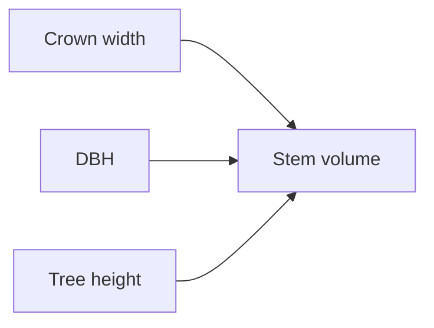

# Tree-Level Allometric Scaling

Existing concept site-index-and-yield explicitly restricts coverage to stand-level site index, dominant height, basal area, and yield capacity, leaving individual tree DBH, crown width, crown base height, and stem volume relationships unrepresented.

This page names the shared idea. It does not open an experiment folder. [[project/domains]] does not gain a new program from this page.

## What the sources describe

- [[sources/paper-a crown width-diameter model for natural even-aged black pine forest management-forests-09-00610-v2]] — Nonlinear fixed and mixed-effects crown width models for Pinus nigra using DBH, competition metrics, and variance modeling.
- [[sources/paper-a rapid method for estimating the median diameter of the stem profile of norway spruce trees-iforest_ifor1945-009_vasilescu]] — Presents empirical models demonstrating that the median diameter of the longitudinal stem profile in Norway spruce occurs at ~0.3 × height and is strongly predicted by DBH.
- [[sources/paper-a_linkage_among_tree_diameter_height_crown_base_he]] — Vasicek-type 4-variate stochastic differential equation framework modeling Scots pine DBH, height, crown base height, and crown width dynamics over stand age.
- [[sources/paper-alder_allometry_cpi023]] — Empirical stem volume models, basic wood density, and stand yield relationships for Alnus incana and Alnus glutinosa across Sweden.
- [[sources/paper-allometric relationships of selected european tree-gp_eudor_pdfa1b_euna20855enc_001]] — Compendium of allometric equations for crown radius, tree height, crown base height, LAI, and biomass for five European commercial species (birch, beech, larch, Norway spruce, Scots pine).

Stand dominant height, site index, and stand volume stay on [[concepts/site-index-and-yield]].

## Replication notes

Coefficients stay on the source pages. Nothing here is implemented in the detection pipeline.

| Paper | Our status |
|---|---|
| [[sources/paper-a crown width-diameter model for natural even-aged black pine forest management-forests-09-00610-v2]] — A Crown Width-Diameter Model for Natural Even-Aged Black Pine Forest Management | TBD |
| [[sources/paper-a rapid method for estimating the median diameter of the stem profile of norway spruce trees-iforest_ifor1945-009_vasilescu]] — A rapid method for estimating the median diameter of the stem profile of Norway spruce (Picea abies Karst) trees | TBD |
| [[sources/paper-a_linkage_among_tree_diameter_height_crown_base_he]] — A Linkage among Tree Diameter, Height, Crown Base Height, and Crown Width 4-Variate Distribution and Their Growth Models: A 4-Variate Diffusion Process Approach | TBD |
| [[sources/paper-alder_allometry_cpi023]] — Stem volume equations and basic density for grey alder and common alder in Sweden | TBD |
| [[sources/paper-allometric relationships of selected european tree-gp_eudor_pdfa1b_euna20855enc_001]] — Allometric Relationships of Selected European Tree Species | TBD |

## Related

- [[concepts/site-index-and-yield]] — stand site index and stand volume
- [[concepts/crown-ownership]] — a crown box is not yet a measured crown width
- [[concepts/canopy-height-model]] — tree height read from the canopy surface
- [[project/domains]] — allometry program not started
