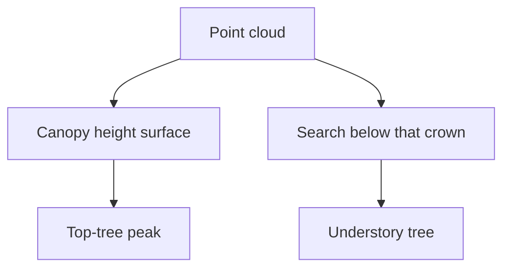

# Understory tree detection

An understory tree stands below another crown. A canopy height model records the upper surface, so a peak on that surface is the top tree. The stem underneath has no peak of its own. Side-by-side overlap in a closed canopy is a different problem. That one lives on [[concepts/dense-stand-detection]].

This page names the idea. It does not open an experiment folder.

## What the sources do

[[sources/paper-tree_crown_segmentation_in_three_dimensions_using_density_models_derived_from_airborne_laser_scanning-holmgren_j_et_al_220114]] first matches a crown template on the point cloud and splits the top layer with a watershed. Inside each top segment it then runs a 3D mean-shift on model-fit strings and picks out trees that sit lower in the same column.

[[sources/paper-a simple oriented search and clustering method for extracting individual forest trees from als point clouds-1-s2-0-s157495412400520x-main]] never builds that surface. It walks upward through a spherical neighborhood until it reaches a local top, so a lower stem can become its own cluster before the path joins a taller tree. On the NEWFOR benchmark that bottom-up walk found more trees in the shorter height bands than CHM detectors and the deep-learning detectors in that comparison.

Both papers say the same limit: points in the middle and lower layers are barely used once the method keeps only the canopy surface.

## In our pipeline

[[methods/chm-detection]] and [[methods/local-maxima]] read the upper surface. They are the top-tree path in the diagram. An understory pass would be a second step on the same cloud, after a top crown is already marked. Whether that step belongs in the current program is not decided here.

## Replication notes

Steps and fitted templates stay on the source pages. Nothing here is implemented.

| Paper step | Our status |
|---|---|
| [[sources/paper-tree_crown_segmentation_in_three_dimensions_using_density_models_derived_from_airborne_laser_scanning-holmgren_j_et_al_220114#Replication pseudocode]] — 2D template match, then 3D mean-shift inside the segment | TBD |
| [[sources/paper-a simple oriented search and clustering method for extracting individual forest trees from als point clouds-1-s2-0-s157495412400520x-main#Replication pseudocode]] — upward search from the cloud to a local top | TBD |

## Related

- [[concepts/dense-stand-detection]] — neighboring crowns that touch, not a tree hidden underneath
- [[concepts/canopy-height-model]] — the surface that hides the lower stem
- [[methods/chm-detection]]
- [[methods/local-maxima]]
