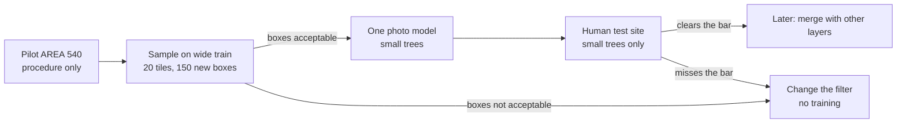
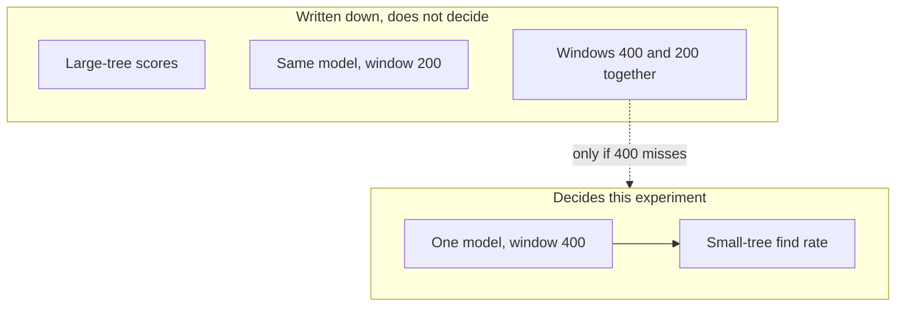

# exp-004 RGB small-student on pseudo v2

**Queue:** after [[experiments/exp-001-per-layer-baselines]] (H1 / exp-001a closed) and [[experiments/exp-002-rgb-seg-backend-ceiling]] (H3 closed preliminary). **Before** [[experiments/exp-003-merge-fusion-v1]] (H2). **No hypothesis id** — this is a small-tree detection follow-up, not H4.  
**Gate:** ADR-002 sequencing note (2026-10-13) — H2 and any H3 follow-up wait until this page’s small-tree usefulness gate. GPU Phase B starts only after a human accepts the Phase A audit.  
**Status (2026-10-13):** proposed; no runs yet.

## Executive summary (for the board)

**Next bet — one camera model that finds more small trees (exp-004)**

Earlier tests showed two things leadership can treat as settled. First, the aerial model finds most **large** trees and misses most **small** ones. A specialist trained on our rough labels finds more small trees, but adding **more forest areas with the same rough labels** did not improve the human-checked test site. Second, drawing crown outlines (exp-002) is already decent **when a tree has a box**; the product gap is still **finding** the small trees.

This experiment trains **one** photo-based detector aimed at small trees. We do **not** combine it with the large-tree model, height maps, or peak detection in the score we use to decide success. Large trees stay on the existing large-tree path until a later merge step.

The new idea is the **training set**, not another geography dump: use the current specialist to propose trees that the rough labels missed, keep only proposals that pass a check, spot-check them with people, then train. A language/vision model may help flag suspicious gaps; it does not draw the final boxes.

**Nothing has been run yet.** GPU training starts only after that spot-check looks honest. Merge of detection layers (exp-003) waits until this model clears an agreed bar on small trees.

Same limit as before: the test site is young forest with **space between crowns**, not a closed dense canopy.



## Hypothesis

#### For the board

We test whether **better training labels** — filling holes in the rough labels we already have — let **one** photo model find more small trees on the fixed human-checked site than the specialist we already trained. We are **not** asking that same model to also be good at large trees. That job stays with the current large-tree path and, later, with merge.

On hold-out `kaxen_197_1`, a **single** DEIMv2 checkpoint, evaluated **only** at SAHI **400**, raises small-tree recall above Round 1 FT ([[experiments/exp-001-per-layer-baselines]]: `R_small` 0.252, `AP_small` 0.157 at slice 400) when supervision is **pseudo v2** (existing weak boxes **plus** machine-filtered gap proposals), not another geography expansion of the same weak labels. **`AP_large` on this checkpoint is out of scope** — large trees stay on `svk_full@800` and later LM/CHM merge. The margin over 0.252 / 0.157 is **TBD** and must be set before the A0 CVAT task opens — a raw “greater than” lets noise through.

#### Takeaway

Success is a **better small-tree finder in one model**, measured on the same human test site as exp-001 — not a new merge and not “we labelled more area the old way.”

## Motivation

#### For the board

Hand-drawing every small crown is not realistic. Adding more area with the **same** automatic labels already failed to move the human test (Round 2). Crown drawing is not the bottleneck right now. So the next cycle should improve **what the small-tree model learns from**, then judge it alone, before we plug it into the rest of the stack.

- Round 2 FT (more R AREAs, same weak-label generator) did **not** beat Round 1 on golden ([[experiments/exp-001-per-layer-baselines]]). Volume without a better teacher is not the lever.
- Bank C (`svk_full@800` ∪ FT@400) remains the **product reference** for multi-scale RGB (`R_small` 0.257). It is **not** the success metric here — this experiment asks whether **one** small-tree student can move the single-pass ceiling.
- H3 ([[experiments/exp-002-rgb-seg-backend-ceiling]]) closed preliminary: matched crown shape is usable under current boxes, but **small-tree detection** limits end-to-end confidence. Masks do not replace bbox supervision.
- Data strategy: gold is scarce; expand with filtered pseudo labels ([[project/research-tree-detection-ensemble]] §4). VLM gap-finding is an optional auditor on top-K slices ([[sources/paper-refdrone_llms]]), not the box author. Multi-model consensus informs the **filter**, not runtime merge ([[sources/paper-multi_llm_detections]]).
- Production merge of LM / CHM / RGB stays in [[methods/merge-detections]] and exp-003 — **after** this gate.

#### Takeaway

The next cycle is **label quality for one small-tree model**. Combining layers comes after that model is good enough on its own.

## Pseudocode

#### For the board

In plain terms: (1) on training images only, the current specialist proposes trees the rough labels missed; (2) a box stays only if the tighter window agrees; (3) people review a sample of those kept boxes — if too many are the wrong size or not a tree, **stop and do not train**; (4) train **one** model starting from that specialist, on the old labels **plus** the kept proposals; (5) score it on the human test site at the window size we already trust for small trees. A tighter window is a side check, not a second product. Combining two window sizes is a fallback only if the single window fails.

**Inputs:** Round 1 weak COCO on AREAs **473–479** only; Round 1 FT checkpoint as the only teacher on the first pass; orthophoto tiles for those AREAs

**Outputs:** train COCO = existing weak boxes plus proposals that passed the machine filter; audit precision on a sample of those kept proposals; student checkpoint; golden scorecard at SAHI 400 (primary) and 200 (same weights, no merge)

**Parameters:** teacher SAHI 400, confirm at SAHI 200, match IoU 0.5 (same as exp-001); confidence TBD / match exp-001 conf 0.3 unless the run log changes it; DINOv3 and VLM **off** on the first pass; usefulness margins TBD, locked before the A0 CVAT task opens

```text
Phase A — teacher dataset (no student train):
1. Freeze splits. Pseudo and train use AREAs 473–479 only.
   Never in pseudo or train: val 480, test 481, golden kaxen_197_1.
   AREA 540 is the procedure pilot only. It is not a Round 1 train AREA and its audit precision does not stand in for A0.
2. Teacher = Round 1 FT. A proposal is a box at SAHI 400 that does not match current weak GT at IoU 0.5.
3. Keep the proposal only if a SAHI 200 box from the same teacher matches it at IoU ≥ 0.5.
   DINOv3 and VLM are off on this pass (see Gaps).
4. Train COCO = all existing weak boxes on 473–479, plus every proposal kept in step 3.
   The human sample does not delete the other kept proposals.
5. Human-audit per [[concepts/pseudo-label-audit-cvat]].
   Pilot on AREA 540 (procedure only).
   A0 samples 20 tiles × 150 boxes from the proposals already kept for train COCO on 473–479
   (same distribution as training; do not overweight small or low-confidence boxes).
   Tile order = weak-box count, not a visual map.
   If A0 precision is below the pre-agreed bar, stop — do not train.

Phase B — one student:
6. Fine-tune one DEIMv2 initialized from Round 1 FT (not from svk_full).
   Train on the COCO from step 4. Do not replace weak GT with proposals only.
7. Score golden at SAHI 400 only for the gate: R_small, AP_small, precision.
   Beat Round 1 FT @400 (0.252 / 0.157) by the pre-agreed margin on both R_small and AP_small,
   and keep precision within the pre-agreed floor. Log AP_large as diagnostic, not a gate.
8. Ablation: same checkpoint at SAHI 200, no merge with 400 and no 800 bank.
   svk_full init is a later run only if step 7 misses the gate.

Phase C — only if Phase B misses the gate:
9. Optional inference merge of windows 400 and 200 with a size gate (run id B400u200; still no 800).
   If that also misses, iterate Phase A (teacher), do not add AREAs of unchanged weak GT.
10. A second backbone is a later run only after A passed audit and B failed to beat Round 1.
```

What is scored, and what is only written down:



### Prerequisites

- Round 1 FT weights and exp-001 eval protocol (size bin `small_max_rel_area_pct = 0.1`, IoU 0.5, conf 0.3 unless changed in the run log)
- **Splits:** train and pseudo = AREAs **473–479** only. Out of pseudo and out of train: val **480**, test **481**, golden `kaxen_197_1`. AREA **540** = CVAT procedure pilot only, not an A0 precision forecast
- Human audit per [[concepts/pseudo-label-audit-cvat]]: AREA 540 procedure pilot, then 20 tiles / 150 kept proposals on 473–479 (not the full train upload)

### Human gate (before GPU train)

#### For the board

Before the next training run, people review a **capped sample** of boxes the filter already kept. The first task is a **procedure check on one area (540)**. The sample that can unlock training is still 20 tiles and 150 boxes on AREAs 473–479. They do not relabel the forest and they do not draw dense versus sparse zones by eye. The question is whether those boxes are **acceptable** (a tree, and a usable size), not only whether a tree exists somewhere nearby. If that wider sample is below the bar, we change the filter and we do not train. Two bars are agreed **before** that task is opened: audit precision, and how far the trained model must beat Round 1 on small trees (including a precision floor). Full procedure: [[concepts/pseudo-label-audit-cvat]].

| Tier          | Item                                                                   |
| ------------- | ---------------------------------------------------------------------- |
| **Mandatory** | Build gap-fill proposals on train tiles only; hold-out stays untouched |
| **Mandatory** | CVAT precision sample per [[concepts/pseudo-label-audit-cvat]] (not a full train upload) |
| **Mandatory** | One student, scored at window **400** on the human test site           |
| **Optional**  | Vision-language model as a gap flag on the worst slices only           |
| **Later**     | Second model family; combining windows 400 and 200                     |

### Gaps

- First-pass filter is locked (400 proposal confirmed at 200). DINOv3 and VLM stay **off** until a later pass
- Exact margins vs Round 1 are **TBD** (two numbers: audit precision, and the beat on both `R_small` and `AP_small` plus a precision floor). Do not treat bank C `R_small` 0.257 as the single-model target. Do not treat a 0.001 gain as a win
- Second backbone identity TBD and not in the first train
- `svk_full` init is not B1
- Production R-class tiles are 100/50 px — SAHI 400/200 remains a research proxy ([[methods/merge-detections]])

#### Takeaway

The plan is a **checked sample of new labels, then one training run**. People do not look at every new box. We will not call two window sizes “one model” unless the single window fails.

## Evaluation protocol

#### For the board

The decision number is: **on the same human-checked site as before, how many small trees does this one model find**, at the window size we already use for small crowns. A second, weaker test area is a watch-out, not the verdict. Scores on large trees are written down so we see side effects, but they do **not** pass or fail this experiment.

- **Primary:** one checkpoint, SAHI **400**, golden `kaxen_197_1`, size bin small, IoU 0.5
- **Monitor:** weak test AREA 481 (not a substitute for golden)
- **Diagnostic only:** `AP_large` / `R_large`; SAHI 200 single-pass; Phase C 400∪200 if run
- **Out of primary:** bank with slice 800; LM/CHM merge; mask metrics (exp-002 already closed preliminary)
- Regime: small-sparse R-class — not closed-canopy dense ([[concepts/dense-stand-detection]])

#### Takeaway

Read the result as **small-tree find rate for one photo model**. Do not average it with large trees, and do not treat a two-window merge as the headline.

## Success criteria

#### For the board

**Success** means two gates. First, the new training boxes survive a human spot-check. Second, the trained model finds **more small trees** on the fixed test site than the specialist we already have, without a collapse in how often a reported tree is real (the exact margin is still to be set). We do **not** require this model to match today’s large-tree performance.

- Phase A audit: kept proposals are mostly **acceptable boxes** on the human sample (precision bar TBD before a training run is treated as informative). `accept_resize` counts as not acceptable
- Phase B: on golden @400, `R_small` and `AP_small` beat Round 1 FT @400 (0.252 / 0.157) by the pre-agreed margin, and precision stays at or above the pre-agreed floor
- Written note that large-tree scores on this checkpoint are **not** required before exp-003

#### Takeaway

Success is a **clear improvement on small trees for one model**, good enough to justify plugging it into merge later.

## Kill criteria

#### For the board

**Stop** if the kept boxes are mostly not acceptable — then we fix the proposal method and we do not start training. **Stop the “more forest, same labels” path** if, after the agreed number of training runs, the model still does not beat the current specialist on the human test by the pre-agreed margin. A single fallback that combines two small-tree window sizes is allowed once; it does not reopen the large-plus-small product merge inside this experiment.

- Phase A audit precision below the pre-agreed bar → do not train; change the teacher filter
- After the agreed number of training runs, the student does not beat Round 1 FT @400 on golden `R_small` and `AP_small` by the pre-agreed margin, or precision falls through the floor → stop “more AREA, same weak GT”; iterate the teacher or stop this track
- Run `B400u200` (windows 400 and 200) is allowed once; it does not reopen an 800∪400 bank inside this experiment

#### Takeaway

A kill here is a **data-quality stop**, not a failed product. The current merged specialist path from exp-001 stays the shipping reference until this gate passes.

## Setup

#### For the board

We reuse the specialist we already trained. We do not bring in height or peak detectors for the score. We do not blend this model with the large-tree window in the number we report to leadership.

- Student: DEIMv2, init = Round 1 FT. `svk_full` only if B1 misses the gate
- Train COCO = weak boxes on 473–479 plus machine-kept proposals. Audit does not drop the rest
- No LM/CHM in the scorecard
- No slice-800 merge
- First-pass teacher filter: 400 confirmed at 200. No DINOv3, no VLM

#### Takeaway

Setup stays **one photo model, small trees, checked labels**.

## Runs

#### For the board

| What we call it | Plain English | Priority |
|-----------------|---------------|----------|
| **A0-pilot** | Same check on **one area (540)** — does the workflow work? | **First.** Does not approve training |
| **A0** | Build the extra boxes on the wide train set and **people check a sample** | **Must pass before any training** |
| **B1** | Train one model; score small trees at the main window | **The decision run** |
| **B1-200** | Same model, tighter window, no combining | Side check |
| **B400u200** | Combine the two small windows | Only if B1 misses the bar |

| Run | Config / baseline | Notes |
|-----|-------------------|-------|
| A0-pilot | AREA 540 only + CVAT sample | Procedure check; not the train gate |
| A0 | pseudo v2 on Round 1 train + CVAT 20×150 | Gate before any train |
| B1 | student, init TBD, eval SAHI 400 | Primary |
| B1-200 | same weights, SAHI 200 | Ablation, no merge |
| B400u200 | windows 400 ∪ 200, size gate | Only if B1 misses the gate. Not exp-002 run C1 |

#### Takeaway

No training run is “the experiment” until **A0** (not the 540 pilot alone) has a written human check.

## Results

#### For the board

No numbers yet. When they arrive, the board table should show: spot-check quality of new boxes, then small-tree find rate versus today’s specialist — not a blended score with large trees.

| Run | Metric | Value | Split | Notes |
|-----|--------|-------|-------|-------|
| | | | | Not run |

#### Takeaway

**Not run.** Do not quote a gain until A0 and B1 are filled in.

When numbers exist, add a chart from the scoring script as `jpg` or `png` next to the table (same pattern as exp-001 box plots). Do not draw a result chart before the run.

## Conclusion

#### For the board

**Not started.** This page is the agreed next detection project. Layer-merge and extra crown-model comparisons stay queued until small-tree finding improves.

**not run** — page records the agreed next detection track. Do not start [[experiments/exp-003-merge-fusion-v1]] or deferred H3 backends on the assumption that small-tree detection is already good enough.

#### Takeaway

Leadership decision for now: **next engineering bet is better labels and one small-tree model**; merge waits.

## Handoff to coding module

#### For the board

Engineering returns a **spot-check result** and a **small-tree scorecard** on the fixed test site. Model files stay in the training repository, not in this wiki. Training does not start until the spot-check is accepted.

- Hold-out: `kaxen_197_1` never in train or in pseudo targets. AREA 481 = monitor only
- Teacher: Round 1 FT checkpoint already used in exp-001 (`research/exp-001/` ladder tag `002`)
- Deliver back: audit precision; golden table at 400 (`R_small`, `AP_small`, P) vs Round 1 FT @400; optional 200 ablation
- Out of scope: weights in this repo; LM/CHM fusion; slice 800 bank; exp-003 until the gate above is met
- Human gate after Phase A audit, before Phase B GPU

#### Takeaway

The handoff is **audit first, train second, merge not yet**.

## Related

- [[concepts/pseudo-label-audit-cvat]]
- [[experiments/exp-001-per-layer-baselines]]
- [[experiments/exp-002-rgb-seg-backend-ceiling]]
- [[experiments/exp-003-merge-fusion-v1]]
- [[project/decisions]] — ADR-002 sequencing note (2026-10-13)
- [[project/research-tree-detection-ensemble]]
- [[methods/deimv2-canopy]]
- [[methods/merge-detections]]
- [[sources/paper-refdrone_llms]]
- [[sources/paper-multi_llm_detections]]
