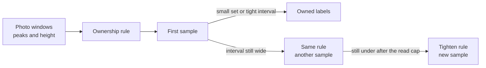

# exp-005 normal-forest ownership smoke

**Queue:** draft, and the next smoke under proposed ADR-003 ([[project/decisions]]). **No hypothesis id.** This is not H4. H1 stays on [[experiments/r-class-itd/exp-001-per-layer-baselines]], H3 on [[experiments/r-class-itd/exp-002-rgb-seg-backend-ceiling]], H2 on [[experiments/r-class-itd/exp-003-merge-fusion-v1]] (parked).  
**Gate:** do not open CVAT until the height floor, the precision bar, the small-set count, and the read cap are locked. All four are still proposals. The whole path is [[project/normal-forest-flow]].  
**Status (2026-10-21):** draft. Not started. No training in this experiment.

## Executive summary (for the board)

On one small normal-forest site, still to be named, we ask whether the wide-window photo boxes that contain a single treetop and clear a height floor are acceptable crowns. People check a fixed sample. They do not draw the stand, and they do not upload the whole site. Unread boxes become labels only when the set is small, or when the lower end of the interval reaches the proposed bar. Otherwise they stay candidates. There is no student in this experiment.



#### Takeaway

This smoke accepts or rejects a labeling rule. It does not train a model, and it does not score small-tree sites we already have.

## Hypothesis

#### For the board

The question, not a proven claim: on the named AREA, are the wide-window boxes with one peak in the middle, and tall enough, acceptable crowns on a 150-box sample? The numbers 0.95 and 0.80 are the proposed bar to lock before CVAT. They are not signed. Finding-rate and small-tree scores are out of this question. A kill does not authorize training.

On one normal-forest test AREA (id TBD), are SAHI 800 boxes that contain one local-maxima peak in the core and sit above the height floor acceptable crowns at precision ≥ 0.95 on a 150-box sample? Success is that precision and agreement ≥ 0.80, after the bar is locked. The core and the statuses are [[concepts/crown-ownership]]. The cohort is [[concepts/normal-forest]].

Unread candidates become ground truth only on one of two paths, both still to lock before CVAT. Path 1: the candidate count is small enough that 150 is a large share (that count is TBD). Path 2: the lower end of a 95% Wilson interval on the sample reaches the proposed 0.95 bar, adding reads from the same rule if the interval is still too wide. A raw 0.95 on 150 boxes does not by itself promote unread boxes. Otherwise they stay candidates.

#### Takeaway

One question: does this frozen rule clear the proposed sample bar? AP and `R_small` are not part of the answer.

## Motivation

#### For the board

Small-tree training stopped before it started ([[experiments/r-class-itd/exp-004-rgb-small-student-pseudo-v2]]). The commercial priority is larger crowns with separable tops ([[project/research-normal-forest]]). This smoke is phase 1 of that proposal. It reuses the verdict list from [[concepts/pseudo-label-audit-cvat]] and does not reopen exp-004 Phase B.

### Illustration, not a milestone, not a gate

One 800×800 tile, file `01_y0_x0.jpg`, cut from `research/exp-004/image (1).png`. Not AREA 540. Not golden. `svk_full` SAHI 800 found 100 crowns. A Gemini 4 hole-fill pass listed 230. SAHI 400 found 317, of which 194 have their center outside every 800 box. Of the Gemini boxes whose centers fall outside the 800 map, 120 contain a 400-proposal center and 12 do not. Forty of the 194 proposals lie in no Gemini box. Forty-five of the 317 slice-400 boxes have their center outside every Gemini box.

Read this as: the 800 map is the crown layer, 400 is the proposal layer, and the VLM is a review aid. These counts are not success thresholds and they are not a result of this experiment.

#### Takeaway

The tile is a picture of the label path. It is not a milestone and it does not set the pass bar.

## Pseudocode

#### For the board

Name the site. Confirm the four layers are already on disk. Count how many wide-window boxes have exactly one peak in the middle. People then review only the candidates, up to 20 tiles and 150 boxes. Write the precision. List the tighter-window proposals and do not audit them here. Do not train. Do not paint a whole tile in this smoke. Do not draw outlines here.

**Inputs:** one normal-forest test AREA, id TBD; existing `svk_full` at SAHI 800; existing DEIMv2 at SAHI 400; existing local maxima; existing CHM. Not `kaxen_197_1`. Not AREA 540. Not AREA 481.

**Outputs:** count of 800 boxes with exactly one peak in the core; CVAT sample of candidates only; `ownership_precision` and `reader_agreement`. A list of proposals, not an audit of them.

**Parameters:** core = central half, from `(x + 0.25w, y + 0.25h)`, size `0.5w` by `0.5h`; one peak only; CHM height floor TBD, written before CVAT; proposed bar precision ≥ 0.95 and agreement ≥ 0.80, locked before CVAT, not signed. For unread boxes, path 2 compares the lower end of a 95% Wilson interval with that 0.95 bar. The small-set count and the read cap are TBD, written before CVAT. Slice sizes in this experiment are 800 and 400. Slice-100 CHM detections are not a witness.

```text
1. Choose the AREA. Id TBD.
   Not kaxen_197_1. Not AREA 540. Not AREA 481.
   Confirm four existing layers: svk_full at 800, DEIMv2 at 400,
   local maxima, CHM. Do not train.
2. An ownership candidate is an 800 box with exactly one local-maxima peak
   in the core and CHM height above the R-class floor.
   Two peaks in one 800 box: not a candidate.
   The height floor is TBD and must be written before CVAT opens.
   CHM detections at slice 100 px are not a witness.
3. Count how many 800 boxes get exactly one peak in the core.
   If the AREA has no separable peaks, kill.
   Kill does not authorize training.
4. CVAT sample of candidates only, per crown-ownership and the audit page.
   Up to 20 tiles and 150 candidates.
   Ten tiles from the high half of peak counts, ten from the low half.
   Thirty boxes read by a second person.
   Do not upload the whole AREA.
   Verdicts: accept, reject, accept_resize. unset must be 0.
   precision = accept / (accept + reject + accept_resize).
5. Write precision and agreement.
   Proposed bar, lock before CVAT: precision ≥ 0.95 and agreement ≥ 0.80.
   Agreement under 80%: the sample does not count. Re-read those 30.
   Do not grow the sample to dilute disagreement.
   A wide interval is not an agreement failure.
   Unread candidates become owned only by one of two paths.
   Path 1 — small set: 150 is a large share of the candidate count.
   The count that counts as small is TBD, written before CVAT.
   Path 2 — same rule, wider sample: the lower end of a 95% Wilson
   interval reaches the proposed 0.95 bar. A raw 0.95 on 150 boxes
   does not by itself promote unread boxes. If the lower end is still
   under the bar, draw another sample from the same frozen rule and
   the same pool. Do not tighten yet.
   Sample rejects and accept_resize are removed on either path.
   Otherwise unread candidates stay candidates.
   One frozen rule covers the whole set. Do not split it into batches.
6. Fail of path 2 after the read cap: nobody is owned. The cap number
   is TBD, written before CVAT. Do not treat about 450 reads as that cap.
   Then tighten (peak closer to the center, or a higher height floor)
   and draw a new sample. The boxes stay on disk.
   Do not re-label the same boxes until the fraction looks better.
7. Proposals are SAHI 400 boxes whose center lies outside every owned box.
   List them. Do not audit them in this experiment.
8. One fully painted tile is a follow-up, not this smoke.
   Segmentation is a follow-up. There is no student in this experiment.
   A VLM box is not a label. A missing VLM box does not delete a detector box.
```

### Prerequisites

- AREA id written down. Four layers already produced for that AREA. No new training to create them.
- Height floor written before the CVAT task opens.
- Proposed precision bar and agreement bar locked before import. Until then both stay proposals.
- Human sample mechanics: [[concepts/pseudo-label-audit-cvat]]. Ownership rules: [[concepts/crown-ownership]].

### Gaps

- AREA id TBD
- Height floor TBD. No metre value on this page
- 0.95 and 0.80 are proposed, not signed
- The count that counts as a small set is TBD. A raw 0.95 on 150 boxes does not promote unread boxes
- The read cap for path 2 is TBD. About 450 reads illustrates a ±2 point interval. It is not the cap
- How many visible crowns lack an owned box is a later fully painted tile, not this smoke
- A student, and weak labels for another region, are later uses on the program page. They are not steps here

#### Takeaway

Existing layers, one sample, a written precision. Proposals are listed. Training is not in the list.

## Evaluation protocol

#### For the board

The only numbers that decide this smoke are the precision of the sampled rule and whether two readers agree. We do not score missed trees in this sample. We do not use the small-tree human site. We do not treat the illustration tile as a score.

- Primary: `ownership_precision` and `reader_agreement` on the candidate sample
- Split of tiles: ten from the high half of peak counts, ten from the low half
- Out of scope: AP, `R_small`, `kaxen_197_1`, AREA 540, AREA 481, open vs dense, mask scores
- Empty pixels are not “no tree” in this smoke

#### Takeaway

Read a pass as “the rule was clean on the sample.” Do not read it as “every crown in the stand was found.”

## Success criteria

#### For the board

Success is a locked bar, then a sample that meets it, and unread boxes promoted only by path 1 or path 2. The bar is proposed: precision at least 0.95 and agreement at least 0.80. Lock it before CVAT. On path 2 the precision gate is the lower end of a 95% Wilson interval, not the raw fraction. Sample rejects and wrong-size boxes come out. Other unread boxes stay candidates unless one of those two paths applies.

- Proposed bar, lock before CVAT: precision ≥ 0.95 and agreement ≥ 0.80
- Unread promotion only by the small-set path or the Wilson lower-bound path. Both still to lock before CVAT
- Do not train
- Do not treat VLM boxes as labels
- Do not upload the whole AREA to CVAT
- Do not use `kaxen_197_1`

#### Takeaway

Success signs unread boxes only on a small set, or when the lower end of the interval reaches the proposed bar. It does not start a student and it does not use the small-tree test site.

## Kill criteria

#### For the board

Stop this rule if, after the written read cap, the lower end of the interval is still under the bar, if the two readers agree on fewer than 80% of the thirty overlap boxes, or if the AREA has no separable peaks. A wide interval on the first 150 is a reason to sample again from the same rule, not a reason to tighten yet. After the cap, tightening and a new sample are the next step. A kill does not authorize training. The boxes stay on disk.

- Path 2 still under the bar after the read cap (cap TBD, written before CVAT)
- Agreement below 80%
- The AREA has no separable peaks
- Do not train
- Do not treat VLM boxes as labels
- Do not upload the whole AREA to CVAT
- Do not use `kaxen_197_1`

AP and `R_small` are out of scope. There is no student in this experiment.

#### Takeaway

A kill throws out the rule, not the forest. It does not send a model to the GPU.

## Setup

#### For the board

Use the photo model and the peak and height layers that already exist. Do not fit a new detector for this smoke. The language model may only flag a box the detector already drew.

- Detector boxes: existing `svk_full` at SAHI 800; existing pass at SAHI 400 for the proposal list
- Witness: one local-maxima peak in the core, plus CHM height above the floor (floor TBD)
- Not a witness: CHM detections at slice 100 px; a VLM-only box
- No student checkpoint. No new geography of weak labels inside this experiment

#### Takeaway

Setup is four layers we already have, plus a human sample. Nothing is trained here.

## Runs

#### For the board

One smoke. If the rule fails, the rerun is a tighter rule and a new sample, still with no training.

| Run | Config / baseline | Notes |
|-----|-------------------|-------|
| S0 | Name AREA; confirm 800, 400, local maxima, CHM | No train. Id TBD |
| S1 | Count 800 boxes with exactly one peak in the core | Kill if none are separable |
| S2 | CVAT sample of candidates only, up to 20×150 | Not the whole AREA. Proposals listed, not audited |

#### Takeaway

Three steps, all before any model training. If the interval is still wide, the next sample uses the same rule. A tighter rule is a later draw, after the read cap.

## Results

#### For the board

No sample has been run. The illustration tile in Motivation is not a result and not a metric.

| Run | Metric | Value | Notes |
|-----|--------|-------|-------|
| S2 | ownership_precision | TBD | Proposed bar not signed |
| S2 | reader_agreement | TBD | Proposed bar not signed |

#### Takeaway

Both cells stay empty until the AREA is named and the sample is read.

## Conclusion

#### For the board

Draft. Not run. Do not accept or reject the hypothesis from the illustration tile. Do not start training from this page. exp-004 stays closed without training. exp-003 stays parked.

#### Takeaway

Nothing is decided until the sample on the named AREA is written down.

## Handoff to coding module

#### For the board

Engineering can prepare the candidate list after four locks: the height floor, the precision bar, the small-set count, and the read cap. Until then, do not open the review task. Do not start a GPU training job. Bring back the precision and the agreement, not a model scorecard. The path after a pass is [[project/normal-forest-flow]].

- Data: one normal-forest AREA, id TBD; existing 800, 400, local maxima, CHM. Describe the layers. Do not invent a new AREA id
- Deliver back: one-peak count; sample size; precision; agreement; shortfall if fewer than 150 candidates
- Out of scope for this handoff: training, student checkpoints, weights in this repo, uploading the whole AREA, VLM boxes as labels, `kaxen_197_1`, a weak-label set for another region, masks

#### Takeaway

The handoff is a candidate list and a sample score, after the bar and the height floor are written down.

## Related

- [[project/normal-forest-flow]] — discussion sheet for the path after this smoke
- [[project/research-normal-forest]]
- [[project/decisions]] — ADR-003 (proposed)
- [[concepts/normal-forest]]
- [[concepts/crown-ownership]]
- [[concepts/pseudo-label-audit-cvat]]
- [[concepts/canopy-height-model]]
- [[experiments/r-class-itd/exp-004-rgb-small-student-pseudo-v2]]
- [[experiments/r-class-itd/exp-002-rgb-seg-backend-ceiling]]
- [[methods/deimv2-canopy]]
- [[methods/local-maxima]]
- [[methods/chm-detection]]
