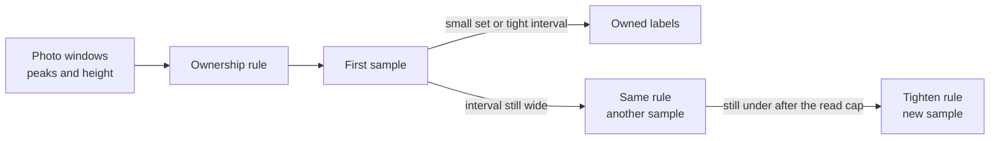
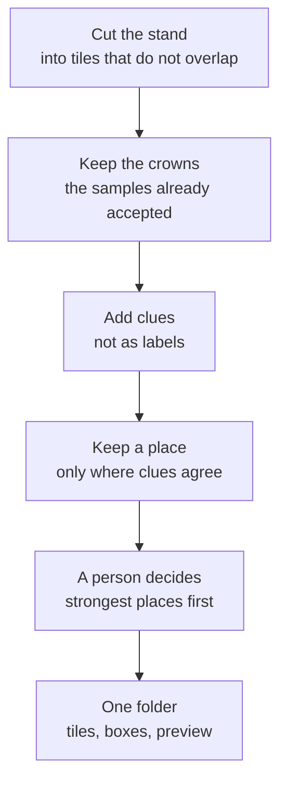

# exp-005 normal-forest ownership smoke

**Queue:** closed as the reference for stand 17568. The next experiment is [[experiments/normal-forest/exp-006-training-labels-backbone]]. **No hypothesis id.** This is not H4. H1 stays on [[experiments/r-class-itd/exp-001-per-layer-baselines]], H3 on [[experiments/r-class-itd/exp-002-rgb-seg-backend-ceiling]], H2 on [[experiments/r-class-itd/exp-003-merge-fusion-v1]] (parked).  
**Gate:** precision ≥ 0.85 and agreement ≥ 0.80 are signed. The sample is read and meets both. Do not train. AREA id is 663-17568. Tree height is at least 7 m, from the local-maxima peak Z. The small-set count is 300. The read cap is 600 candidate boxes. The whole path is [[project/normal-forest-flow]].  
**Status (2026-11-19):** closed. The product is the golden set for stand 17568, 8701 crowns on 168 tiles. The 2026-11-02 sample stands: precision 0.973, Wilson lower end 0.933, agreement 0.80. The 2026-11-04 window-400 sample stands: precision 0.967, agreement 0.867, 2719 labels. The copy of 8601 boxes is not overwritten. Eight boxes from an earlier mask cut are not in that copy. No training. ADR-003 stays proposed.

## Executive summary (for the board)

On AREA 663-17568 we ask whether the wide-window photo boxes that contain a single treetop and clear 7 m are acceptable crowns. People check a fixed sample. They do not draw the stand, and they do not upload the whole site. Unread boxes become labels only when the set is small, or when the lower end of the interval reaches the signed bar. Otherwise they stay candidates. There is no student in this experiment.

The 2026-11-02 sample meets the bar. Precision is 146/150 (0.973). The lower end of a 95% Wilson interval is 0.933. Agreement is 24/30 (0.80). Path 2 applies on this stand. The product of the later correction is one folder of photo tiles and one box per crown. No training.



#### Takeaway

This smoke accepts or rejects a labeling rule. It does not train a model, and it does not score small-tree sites we already have.

## Hypothesis

#### For the board

The question, not a proven claim: on the named AREA, are the wide-window boxes with one peak in the middle, and tall enough, acceptable crowns on a 150-box sample? The numbers 0.85 and 0.80 are the signed bar. Finding-rate and small-tree scores are out of this question. A kill does not authorize training.

On AREA 663-17568, are SAHI 800 boxes that contain one local-maxima peak in the core and sit at a tree height of at least 7 m acceptable crowns at precision ≥ 0.85 on a 150-box sample? The bar is signed: precision ≥ 0.85 and agreement ≥ 0.80. The core and the statuses are [[concepts/crown-ownership]]. The cohort is [[concepts/normal-forest]].

Unread candidates become ground truth only on one of two paths. Path 1: the candidate count is at most 300, so 150 is at least half the pool. Path 2: the lower end of a 95% Wilson interval on the sample reaches the signed 0.85 bar, adding reads from the same rule up to 600 candidate boxes if the interval is still too wide. A raw 0.85 on 150 boxes does not by itself promote unread boxes. Otherwise they stay candidates. The precision bar is signed. The gate on that path is the lower end of the interval.

#### Takeaway

One question: does this frozen rule clear the signed sample bar? AP and `R_small` are not part of the answer.

## Motivation

#### For the board

Small-tree training stopped before it started ([[experiments/r-class-itd/exp-004-rgb-small-student-pseudo-v2]]). The commercial priority is larger crowns with separable tops ([[project/research-normal-forest]]). This smoke is phase 1 of that proposal. It reuses the verdict list from [[concepts/pseudo-label-audit-cvat]] and does not reopen exp-004 Phase B.

### Illustration, not a milestone, not a gate

One 800×800 tile, file `01_y0_x0.jpg`, cut from `research/exp-004/image (1).png`. Not AREA 540. Not golden. `svk_full` SAHI 800 found 100 crowns. A Gemini 4 hole-fill pass listed 230. SAHI 400 found 317, of which 194 have their center outside every 800 box. Of the Gemini boxes whose centers fall outside the 800 map, 120 contain a 400-proposal center and 12 do not. Forty of the 194 proposals lie in no Gemini box. Forty-five of the 317 slice-400 boxes have their center outside every Gemini box.

Read this as: the 800 map is the crown layer, 400 is the proposal layer, and the VLM is a review aid. These counts are not success thresholds and they are not a result of this experiment.

#### Takeaway

The tile is a picture of the label path. It is not a milestone and it does not set the pass bar.

## Pseudocode

#### For the board

Name the site. Confirm the photo boxes and the peaks are already on disk. Count how many wide-window boxes have exactly one peak in the middle. People then review only the candidates, up to 20 tiles and 150 boxes. Write the precision. List the tighter-window proposals and do not audit them here. Do not train. Do not paint a whole tile in this smoke. Do not draw outlines here.

**Inputs:** AREA 663-17568; existing `svk_full` at SAHI 800; local maxima. Tree height is the peak Z. Not `kaxen_197_1`. Not AREA 540. Not AREA 481. SAHI 400 is the later proposal list. CHM detections are out of this smoke.

**Outputs:** count of 800 boxes with exactly one peak in the core; CVAT sample of candidates only; `ownership_precision` and `reader_agreement`. A list of proposals, not an audit of them.

**Parameters:** core = central half, from `(x + 0.25w, y + 0.25h)`, size `0.5w` by `0.5h`; one peak only; tree height at least 7 m, from the peak Z; signed bar precision ≥ 0.85 and agreement ≥ 0.80. For unread boxes, path 2 compares the lower end of a 95% Wilson interval with that 0.85 bar. The small-set count is 300. The read cap is 600 candidate boxes. Slice sizes in this experiment are 800 and 400. Slice-100 CHM detections are not a witness.

```text
1. The AREA is 663-17568.
   Not kaxen_197_1. Not AREA 540. Not AREA 481.
   Confirm svk_full at 800 and local maxima. Do not train.
   Tree height comes from the peak Z. CHM detections are out of this smoke.
2. An ownership candidate is an 800 box with exactly one local-maxima peak
   in the core and tree height above 7 m.
   Tree height is the peak's Z.
   Two peaks in one 800 box: not a candidate.
   CHM detections at slice 100 px are not a witness.
3. Count how many 800 boxes get exactly one peak in the core.
   If the AREA has no separable peaks, kill.
   Kill does not authorize training.
4. CVAT sample of candidates only, per crown-ownership and the audit page.
   Up to 20 tiles and 150 candidates.
   Ten tiles from the high half of peak counts, ten from the low half.
   Thirty boxes read by a second person.
   Do not upload the whole AREA.
   Verdicts: accept, reject, accept_resize. unset must be 0.
   precision = accept / (accept + reject + accept_resize).
5. Write precision and agreement.
   Signed bar: precision ≥ 0.85 and agreement ≥ 0.80.
   Agreement under 80%: the sample does not count. Re-read those 30.
   Do not grow the sample to dilute disagreement.
   A wide interval is not an agreement failure.
   Unread candidates become owned only by one of two paths.
   Path 1 — small set: the candidate count is at most 300.
   Then 150 is at least half the pool.
   Path 2 — same rule, wider sample: the lower end of a 95% Wilson
   interval reaches the signed 0.85 bar. A raw 0.85 on 150 boxes
   does not by itself promote unread boxes. If the lower end is still
   under the bar, draw another sample from the same frozen rule and
   the same pool. Do not tighten yet.
   Sample rejects and accept_resize are removed on either path.
   Otherwise unread candidates stay candidates.
   One frozen rule covers the whole set. Do not split it into batches.
6. Fail of path 2 after the read cap: nobody is owned. The cap is 600
   candidate boxes, four samples of 150. About 1200 reads is the
   arithmetic for a ±2 point interval around 0.85 and is not the cap. The thirty
   overlap reads do not count toward the 600.
   Then tighten (peak closer to the center, or a higher tree height)
   and draw a new sample. The boxes stay on disk.
   Do not re-label the same boxes until the fraction looks better.
7. Proposals are SAHI 400 boxes whose center lies outside every owned box.
   List them. Do not audit them in this experiment.
8. One fully painted tile is a follow-up, not this smoke.
   Segmentation is a follow-up. There is no student in this experiment.
   A VLM box is not a label. A missing VLM box does not delete a detector box.
```

### Prerequisites

- AREA id is 663-17568. SAHI 800 and local maxima exist for stand 17568. No new training to create them.
- Tree height is at least 7 m, from the peak Z.
- Signed bar: precision ≥ 0.85 and agreement ≥ 0.80.
- Human sample mechanics: [[concepts/pseudo-label-audit-cvat]]. Ownership rules: [[concepts/crown-ownership]].

### Gaps

- AREA id is 663-17568. The window-400 list on this stand was read on 2026-11-04: precision 0.967, agreement 0.867, 2719 labels. The record is on [[project/normal-forest-flow]]. This experiment does not own that reading. CHM detections are out of this smoke
- Tree height is at least 7 m, from the local-maxima peak Z. A CHM detection is not this measurement
- Signed bar: precision ≥ 0.85 and agreement ≥ 0.80. A raw 0.85 on 150 boxes does not promote unread boxes
- The count that counts as a small set is 300. At 300, a 150-box sample is half the pool. Stand 17568 has 6047 one-peak boxes, so that stand is not a small set. A pool of 10,000 stays an illustration, not the threshold. A raw 0.85 on 150 boxes does not promote unread boxes
- The read cap for path 2 is 600 candidate boxes: four samples of 150. About 1200 reads is the arithmetic for a ±2 point interval around 0.85. It is not the cap. The thirty second reads in each sample count toward agreement, not toward the 600
- On `tile_03`, five visible crowns have neither an owned 800 px box nor an owned 400 px box. They are not added as labels
- A student, and weak labels for another region, are later uses on the program page. They are not steps here

#### Takeaway

Existing layers, one sample, a written precision. Proposals are listed. Training is not in the list.

## Evaluation protocol

#### For the board

The only numbers that decide this smoke are the precision of the sampled rule and whether two readers agree. We do not score missed trees in this sample. We do not use the small-tree human site. We do not treat the illustration tile as a score.

- Primary: `ownership_precision` and `reader_agreement` on the candidate sample
- Split of tiles: ten from the high half of peak counts, ten from the low half
- Out of scope: AP, `R_small`, `kaxen_197_1`, AREA 540, AREA 481, open vs dense, mask scores
- Empty pixels are not “no tree” in this smoke

#### Takeaway

Read a pass as “the rule was clean on the sample.” Do not read it as “every crown in the stand was found.”

## Success criteria

#### For the board

Success is the signed bar, then a sample that meets it, and unread boxes promoted only by path 1 or path 2. The bar is signed: precision at least 0.85 and agreement at least 0.80. On path 2 the precision gate is the lower end of a 95% Wilson interval, not the raw fraction. Sample rejects and wrong-size boxes come out. Other unread boxes stay candidates unless one of those two paths applies.

Unread boxes are not signed because a sample looks good. Stand 17568 has 6047 one-peak boxes. A sample of 150 is 2.5% of that pool. A small set is at most 300 candidates. Then 150 is at least half, and the sample may sign the rest. This stand is not small. Unread boxes stay candidates unless the second path clears. The second path stops after 600 reads, four samples of 150. On 150 boxes the lower end reaches 0.85 only at 137 hits. About 1200 reads shows how wide a ±2 point interval is around 0.85. It is not the cap. After 600, if the lower end is still under 0.85, nobody is owned. The rule gets tighter and a new sample is drawn. The same boxes are not read again to improve the fraction. Thirty boxes read by a second person check agreement. They do not count toward the 600.

- Signed bar: precision ≥ 0.85 and agreement ≥ 0.80
- Small set: at most 300 candidates. Read cap: 600 candidate boxes
- Unread promotion only by the small-set path or the Wilson lower-bound path
- Do not train
- Do not treat VLM boxes as labels
- Do not upload the whole AREA to CVAT
- Do not use `kaxen_197_1`

#### Takeaway

Success signs unread boxes only on a small set, or when the lower end of the interval reaches the signed bar. It does not start a student and it does not use the small-tree test site.

## Kill criteria

#### For the board

Stop this rule if, after 600 candidate boxes, the lower end of the interval is still under the bar, if the two readers agree on fewer than 80% of the thirty overlap boxes, or if the AREA has no separable peaks. A wide interval on the first 150 is a reason to sample again from the same rule, not a reason to tighten yet. After 600, tightening and a new sample are the next step. A kill does not authorize training. The boxes stay on disk.

- Path 2 still under the bar after 600 candidate boxes
- Agreement below 80%
- The AREA has no separable peaks
- Do not train
- Do not treat VLM boxes as labels
- Do not upload the whole AREA to CVAT
- Do not use `kaxen_197_1`

AP and `R_small` are out of scope. There is no student in this experiment.

#### Takeaway

A kill throws out the rule, not the forest. It does not send a model to the GPU.

## Setup

#### For the board

Use the photo model and the peaks that already exist. Tree height is the peak's Z. Do not fit a new detector for this smoke. The language model may only flag a box the detector already drew.

- Detector boxes: existing `svk_full` at SAHI 800. SAHI 400 is the later proposal list
- Witness: one local-maxima peak in the core, plus tree height above 7 m. Tree height is the peak's Z
- Not a witness: a CHM detection, including one at slice 100 px; a VLM-only box
- No student checkpoint. No new geography of weak labels inside this experiment

#### Takeaway

Setup is the photo boxes, the peaks, and tree height from those peaks, plus a human sample. Nothing is trained here.

## Runs

#### For the board

One smoke. If the rule fails, the rerun is a tighter rule and a new sample, still with no training.

| Run | Config / baseline | Notes |
|-----|-------------------|-------|
| S0 | AREA 663-17568. SAHI 800 and local maxima | Tree height from peak Z ≥ 7 m. No CHM detection in this smoke |
| S1 | Count 800 boxes with exactly one peak in the core | Kill if none are separable |
| S2 | CVAT sample of candidates only, up to 20×150 | Read 2026-11-02. 150 boxes, shortfall 0, on 16 tiles. Proposals listed, not audited |

#### Takeaway

Three steps, all before any model training. If the interval is still wide, the next sample uses the same rule. A tighter rule is a later draw, after 600 candidate boxes.

## Results

#### For the board

The candidate sample was read on 2026-11-02. It meets the signed bar. The illustration tile in Motivation is not a result and not a metric. The S1 peak count, which is not that sample, is [[experiments/normal-forest/exp-005-s1-one-peak]]: stand 17568 cut from area 663, SAHI 800 against local-maxima peaks at least 7 m. AREA 665 is not this count.

Stand 17568 has 6047 one-peak boxes. The sample is 150 of them, shortfall 0. Boxes with at least 15% of their area outside the tile were left out before the draw, so the 150 sit on 16 tiles (`tile_00`–`tile_13`, `tile_16`, `tile_17`). Four of the twenty windows were empty. Low-half tiles contributed every eligible box, 8. High-half tiles contributed the other 142. Primary task `exp-005-1`: 146 accept, 3 `accept_resize`, 1 reject, `unset` 0. Precision is 146/150 = 0.973. The lower end of a 95% Wilson interval, z = 1.96, is 0.933. Second task `exp-005-1-verify` read the same 30 boxes. Agreement is 24/30 = 0.80.

Path 1 does not apply. The pool is 6047, and a small set is at most 300. Path 2 does apply: 0.933 reaches the signed 0.85 on this first sample. Unread one-peak boxes on this stand become labels. The three `accept_resize` boxes and the one reject from the primary read stay out. The thirty overlap reads do not count toward the 600. No training. ADR-003 stays proposed.

| Run | Metric | Value | Notes |
|-----|--------|-------|-------|
| S2 | ownership_precision | 0.973 (146/150) | Signed bar ≥ 0.85. Wilson lower end 0.933. 3 `accept_resize`, 1 reject, `unset` 0 |
| S2 | reader_agreement | 0.80 (24/30) | Signed bar ≥ 0.80. Six differ. Each of those six was accept on the primary read |

The six disagreements, joined on the sample annotation id:

| Annotation id | Tile | Primary | Second |
|---------------|------|---------|--------|
| 1 | tile_00 | accept | accept_resize |
| 32 | tile_02 | accept | accept_resize |
| 73 | tile_05 | accept | accept_resize |
| 146 | tile_12 | accept | accept_resize |
| 149 | tile_16 | accept | reject |
| 150 | tile_17 | accept | reject |

#### Takeaway

Both bars are met on the first sample. Path 2 labels the unread one-peak boxes on this stand. The four primary misses stay out. Training stays out.

## One window of the filter

#### For the board

These two pictures are the same 800-pixel window, `tile_03`, on stand 17568. The window is about 29 m across. It is one dense patch, not the whole stand. The pictures show the rule. They are not a second score.

A box stays when one local-maxima peak sits in its central half. The first picture draws those kept boxes. A peak inside the box but outside that central half is blue. A peak outside every kept box is orange. The pink box is the one removed from this window after the human read marked it the wrong size.

The second picture draws the photo-model boxes on the same window that have no peak in the central half. On this window that is 19 boxes. Five of them still contain a local-maxima peak, outside the central half. Fourteen contain no local-maxima peak.

![[exp005-tile03-owned-peaks.png|900]]

Kept boxes on `tile_03`. Yellow: owned box (85 touch the window). Blue: peak in the box, outside the core (19). Orange: peak outside every owned box (17). Pink: the box removed as `accept_resize`, and the peak inside it.

![[exp005-tile03-rgb-no-core-peak.png|900]]

Photo-model boxes on the same window with no peak in the core (19). Cyan: a local-maxima peak inside that box (5).

#### Takeaway

The pictures show which boxes the peak rule keeps and which it drops on one window. They do not replace the sample score.

## Missing crowns on one window

#### For the board

The same window, `tile_03`, was checked for crowns the wide-window boxes do not cover. A first pass followed the peaks that sit outside every owned box. Seventeen of those peaks sit in a gap or on the shoulder of a neighboring crown. That pass is not a count of every bright crown in the photo.

A closer look of the same window, with both owned layers drawn, marks five crowns that have neither an 800 px box nor a 400 px box. That is the miss count for this window. The five are not added as labels. The two samples stay closed. Gaps that are not those five crowns can be treated as background on this window only.

![[exp005-tile03-five-misses.jpg|900]]

Five crowns on `tile_03` with no owned box from either window. Yellow: owned 800 px box (85 touch the window). Blue: owned 400 px box (19 touch the window). Red marks: the five misses.

#### Takeaway

On `tile_03`, five visible crowns have no owned box. They stay out of the labels.

## Nested boxes before outlines

#### For the board

A large box around two crowns is not a label, and a small box inside it does not repair that. The files from the two samples stay as they were. A separate copy is what outlines will use. Where a person saw one crown, the smaller box drops. Where a person saw two crowns, the larger box drops and the other crown still needs its own box. Eight pairs are in that second group. A mask run on five windows the same day used the old boxes, so it was deleted and is not a result.

#### Takeaway

Outlines wait until those eight crowns have their own boxes. The sample scores do not change.

## Reference set a person corrects

#### For the board

This experiment stops as the reference for this stand. The two samples stay closed. A person can still make the reference closer to what is on the photo. They do not redraw the stand. A round touches one kind of gap: a crown with no box, two crowns in one box, or a box that is not a crown. Empty ground stays empty. A second person reads a sample of those edits, not every box. The original sample files are not edited. No training.

The dark line drawn between two crowns on eight pairs stays a picture. It is not a box in this reference.

The copy has 8601 boxes: 6016 from the wide window and 2585 from the tight window. Eight boxes added by an earlier mask cut are left out. The first round is the eight pairs where a person already saw two crowns and the second crown still has no box: `400-1251-1474`, `800-5737-5810`, `800-6041-5908`, `800-6027-5848`, `800-5530-2991`, `800-5974-5151`, `800-5770-5234`, `800-6021-5684`. On four other windows, two readers agreed 19 crowns had no box out of 344 (0.055). That share is a measurement, not a bar. Those crowns are not in this copy until a person adds them on a later round. A figure of 80–90% coverage is not a result of this experiment.

File: `research/exp-005/data/golden/exp005-663-17568-boxes-cvat.json`. The same 8601 boxes sit on 305 photo tiles in `research/exp-005/data/golden/cvat_pack/`. The tiles are cut from the stand photo in storage, one window at a time. The files of 6043 and 2719 boxes stay as the sample record.

That correction closed on 2026-11-19. The folder is the next section. This copy of 8601 boxes is not overwritten.

#### Takeaway

A person corrects a copy. The sample scores do not change, and the line between crowns is not a label.

## Closed golden set

#### For the board

The product of this experiment is one folder for stand 17568. It holds the photo tiles of the stand and one box on each crown that belongs in the set. The two samples stay closed. The folder does not claim that every crown in the photo is in it. A person looked where several clues agreed, and kept or deleted those places. Empty ground stayed empty. No training.



The steps, in the order they were run:

1. Cut the stand into tiles that meet edge to edge, 800 px, with no overlap. A crown is drawn once, on the tile that contains its center. Pixels outside the stand are darkened. The stand boundary is a yellow line. This view is not the earlier overlapping tiles.
2. Keep the 8601 crowns already accepted by the two samples. Do not edit the sample files.
3. Put other clues on the same tiles. They are not labels. A new box stays only when its center is inside the stand, outside the middle of every accepted crown, and no accepted crown center sits inside it. A small box in the outer part of a large crown stays when it is under one third of that crown. A thin box glued to the tile edge is dropped. The clues were: photo boxes that were not yet crowns, new treetops, a second pass of a vision model on these tiles, and height-model boxes in a low band and a high band.
4. Mark a place when two or more new clues have centers within 30 px, and the place is not an accepted crown. A person reads the places with three or four clues first. One decision: a crown of at least 7 m, or not. One box is kept, not every clue. If most of those places are crowns, the person reads the pairs. A pair whose only height clue is the low band stays out. A clue that stands alone stays out.
5. Copy the accepted crowns and the boxes the person kept into one folder. A box whose center lands on a crown already in the set is not copied again. Draw one red line on a preview of each tile.

On this stand the person kept 32 boxes from the 32 strongest places (25 unchanged, 3 resized, 2 places split into two crowns, 2 places deleted) and 69 boxes from 86 pairs (39 unchanged, 30 resized, 17 deleted). One resized pair landed 1.1 px from a crown already in the set and was not copied. The folder has 8701 crowns: 8601 from the samples (6016 wide-window, 2585 tight-window) and 100 from the review. Forty-two pairs whose only height clue is the low band stay out.

The folder is `research/exp-005/data/golden/golden-663-17568/` and `gs://conifer-vision/big-trees/summer/detection_data/golden-663-17568`. It has 168 tiles, `annotations/instances.json` (one category, `tree`), `dataset_metadata.json`, and `preview/` with the same 168 names and a red outline. Twelve tiles have no crown. 1741 boxes extend past the edge of their tile; the file stores the whole crown. Thirty-three crowns have the stand line through the middle and stay, because the center is inside the stand. Two centers sit just outside the line and stay: one from the sample copy, one from the review.

The same steps, written so a later stand can follow them without copying these labels, are [[methods/golden-training-set]].

The other marks on the correction view stay for a person to confirm. They are not in the golden folder. The view for that work is `research/exp-005/data/golden/cvat_stand/annotations/box_and_peak_work.json`. Its small squares are the 8701 confirmed crowns. The other layers stay, except the box a person already kept as one of those crowns. Still open: 225 `box`, 87 `peak_new`, 363 `proposal_ai`, 2460 `chm_lower`, 139 `chm_upper`, and 56 `peak_low`. `peak_low` is a local-maxima peak from 2 m up to, and not including, 7 m, outside every golden crown. A person may keep or delete one of these. Until then it is not a crown in the product. The earlier file `box_and_peak.json` is unchanged.

#### Takeaway

The golden folder is the product. The other layers, including the 2–7 m peaks, stay for a person to confirm. They are not crowns yet.

## Conclusion

#### For the board

The sample on AREA 663-17568 meets the signed bar. Path 2 labels the unread one-peak boxes on stand 17568. The four primary misses stay out. The closed product is the golden folder of 8701 crowns. The other layers on the correction view, including the peaks from 2 m up to 7 m, stay for a person to confirm. They are not part of the 8701. This page does not start training. ADR-003 stays proposed. exp-004 stays closed without training. exp-003 stays parked. The illustration tile is not this result.

#### Takeaway

The smoke sample passed, and the golden folder is the product. The remaining layers wait for a person. Training does not start.

## Handoff to coding module

#### For the board

The sample score is back. AREA id is 663-17568. Tree height is at least 7 m, from the peak Z. The small-set count is 300. The read cap is 600 candidate boxes. Precision is 0.973 (146/150), Wilson lower end 0.933, agreement 0.80 (24/30), shortfall 0. Do not start a GPU training job. The path after this pass is [[project/normal-forest-flow]].

- Data: AREA 663-17568; SAHI 800 and local maxima on stand 17568. Tree height from peak Z. Do not invent another AREA id
- Delivered: one-peak count 6047; sample 150; precision 0.973; agreement 0.80; shortfall 0
- Out of scope for this handoff: training, student checkpoints, weights in this repo, uploading the whole AREA, VLM boxes as labels, `kaxen_197_1`, a weak-label set for another region, masks

#### Takeaway

The handoff returned a sample score, and the score meets the signed bar. Tree height is at least 7 m. Training stays out.

## Related

- [[project/normal-forest-flow]] — discussion sheet for the path after this smoke
- [[project/research-normal-forest]]
- [[project/decisions]] — ADR-003 (proposed)
- [[concepts/normal-forest]]
- [[concepts/crown-ownership]]
- [[concepts/pseudo-label-audit-cvat]]
- [[concepts/canopy-height-model]]
- [[experiments/r-class-itd/exp-004-rgb-small-student-pseudo-v2]]
- [[experiments/r-class-itd/exp-002-rgb-seg-backend-ceiling]]
- [[methods/deimv2-canopy]]
- [[methods/local-maxima]]
- [[methods/chm-detection]]
- [[methods/golden-training-set]] — the same steps, written for a later stand
