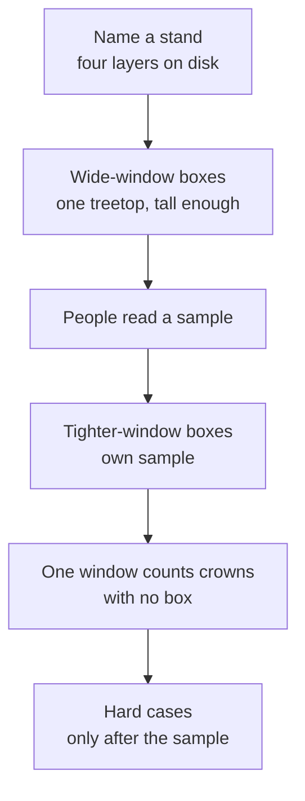
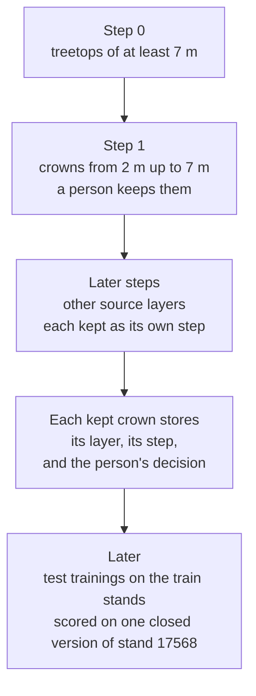

# exp-006 training-label backbone

**Queue:** opened. Stands are named. **No hypothesis id.** ADR-003 stays proposed.  
**Gate:** the bars already signed on exp-005. Precision lower end at least 0.85. Agreement at least 0.80. A label is a tree of at least 7 m, from the peak Z. Small set at most 300. Read cap 600. Do not train.  
**Status (2026-11-24):** stands named on image 670. Layers are named. Each kept object will store its layer, its step, and the person's decision. No photo-box run on the new stands yet. No training.

## Executive summary (for the board)

exp-005 is closed. Its product is one folder of crowns for stand 17568. This experiment prepares the same kind of labels on other stands in that region. People have named the stands. A human check still has to happen on each new stand before its boxes become labels. Hard cases, including two crowns in one box, wait until the ordinary boxes have been sampled. Nothing here is written back into the exp-005 folder. No training.

The first step is still a treetop of at least 7 m. The next step is a crown from 2 m up to 7 m, after a person keeps it. The 2 m floor is the one counted on stand 17568. Further steps are the other source layers. A kept object records which layer it came from and which step added it. Test trainings that compare those steps come later. They are not started. Stand 17568 stays the score set. A comparison uses one closed version of that set.

## What this experiment does

#### For the board

Five steps, and each one waits on the one before it. The stands are named below. Confirm the photo boxes and the treetops are on disk for each new stand. Keep a wide-window box when one treetop sits in its middle and that treetop is at least 7 m. People read a sample of those boxes. A tighter-window box is a separate list, and only when its center sits outside every kept wide-window box. It gets its own sample. On one window, count crowns that have no box and leave them unlabeled. Only then look at the hard cases.

The count of wide-window candidates can be printed before anyone is labeled. The script is `research/exp-006/backbone.py`. With no files set, it prints the five steps and stops. It does not choose a stand. The stands below were named by people.

#### Takeaway

Stands are named. The first step is still a treetop of at least 7 m. Hard cases wait.

## Stands

#### For the board

The region is the one already used for stand 17568. On the map it is image 670, area Brännvattsliden. Stand 17568 stays the set a later model is scored against. Two nearby stands are the test. Three stands about 2 km away are the training stands. A stand that shares a border with 17568 stays out. No new stand has a photo-box run yet, and none of them is labeled.

| Role | Stand | Hectares on the map |
|------|------:|--------------------:|
| Eval, already closed | 17568 | 10.43 |
| Test | 17555 | 4.52 |
| Test | 17556 | 4.51 |
| Train | 17659 | 13.28 |
| Train | 17646 | 4.39 |
| Train | 17647 | 3.75 |

17555 and 17556 share a border, so they stay in the same role. They do not touch 17568. The three training stands do not touch the eval stand or the test stands. On the map these six polygons are class G2. Peaks of at least 7 m: 8943 on 17568, 3992 on 17555, 4571 on 17556, 10917 on 17659, 4087 on 17646, and 3104 on 17647. Median height is about 15 m on each, and 13.6 m on 17646.

#### Takeaway

Eval is 17568. Test is 17555 and 17556. Train is 17659, 17646, and 17647.

## Layers

#### For the board

An adult stand is mixed. Most trees are tall. Some are about 4 or 5 m, and the board wants those found too. On 2026-11-23 this page left the shorter trees unlabeled. That is changed. They enter as their own step, after a person keeps them.

The score set is stand 17568. It is one list of crowns a person stands behind. The score does not care which layer a crown came from. A person may still add crowns to that list. A comparison of training layers uses one closed version of the list, so a crown added later is a new version and the earlier runs are scored again on that version.

The height step is local-maxima crowns from 2 m up to, and not including, 7 m. The 2 m floor is the count on stand 17568: below 2 m the marks are mostly seedlings and noise. The source layers after that, each as its own step, are `box`, `peak_new`, `proposal_ai`, `chm_lower`, and `chm_upper`. A kept object stores the layer name, the step number, and the person's decision. An object the person deletes stays in that record and stays out of the training file.

No test training runs in this step. When those runs start, they use the same recipe on stands 17659, 17646, and 17647. Each run reads the next snapshot. The score is one closed version of stand 17568.

#### Takeaway

This step names the layers and the metadata. The first added layer is 2 m up to 7 m. Training stays later.

## What this experiment does not do

#### For the board

It does not train a model. It does not copy labels into the exp-005 reference. It does not run the test trainings that compare layers. It does not treat a dark line between two crowns as a box. It does not score `kaxen_197_1`, AREA 540, or AREA 481. The question of whether a trained model is useful enough stays unwritten.

#### Takeaway

Labels for a later stand, after a new human sample. No training.

## Related

- [[experiments/normal-forest/exp-005-normal-forest-ownership-smoke]] — the closed golden set this experiment does not edit
- [[methods/golden-training-set]] — draft procedure; the stands are named here, and the new folders are not started
- [[project/normal-forest-flow]]
- [[concepts/crown-ownership]]
- [[concepts/pseudo-label-audit-cvat]]
