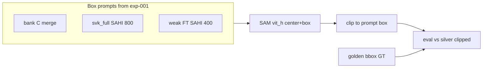
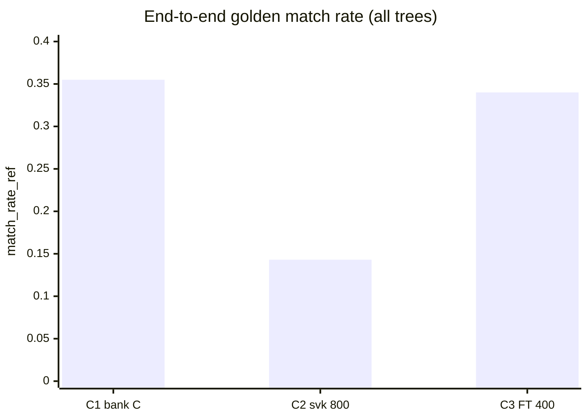
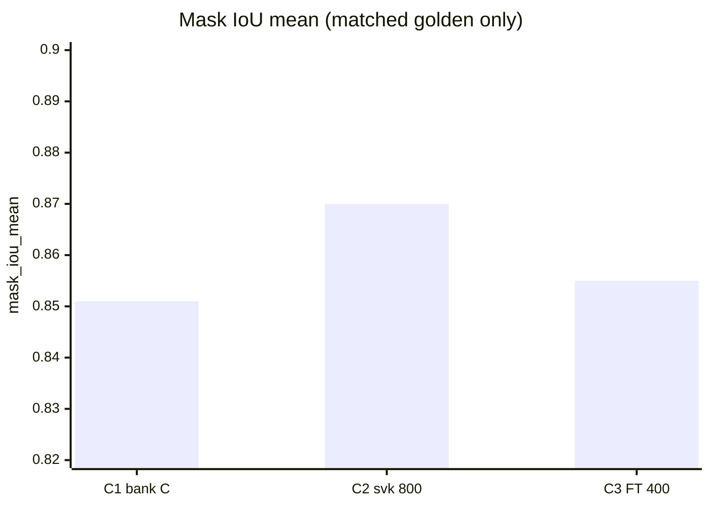
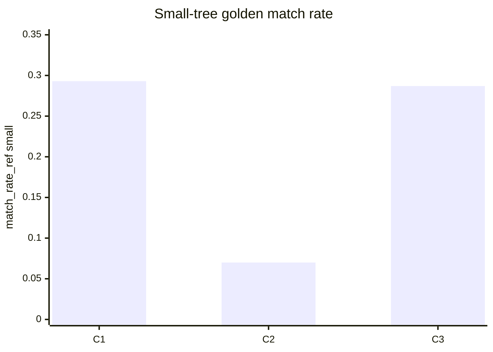

# exp-002 RGB instance-seg backend ceiling (H3 v1.1)

**Queue:** [[experiments/r-class-itd/exp-001-per-layer-baselines]] (H1) → **exp-002 / H3 (this page)** → [[experiments/r-class-itd/exp-003-merge-fusion-v1]] (H2).  
**Gate:** ADR-002 — sequence approved (see [[project/decisions]]). **Start after exp-001a closure** (bbox bank + golden protocol frozen). exp-001b (LM/CHM) may run in parallel; not required for H3 RGB mask bake-off.  
**Status (2026-10-12):** **H3 closed (preliminary).** C1/C2/C3 scored on Workbench (SAM **vit_h**, 5 golden tiles). See **Closure** and [[#Results]]. Optional ECSeg/StarDist **deferred**. Not a claim of production-ready **end-to-end** crown deployment at high business confidence.

## Executive summary (for the board)

**Closure — preliminary crown segmentation quality (exp-002 / H3)**

On the same young-forest hold-out as exp-001 (**five tiles**, **2534** reference trees), we ran a **controlled check of crown outline quality**: AI segmentation (SAM) guided by **detection boxes**, scored against a **silver** reference (machine crowns clipped to human boxes — not a second full manual paint of every pixel). We compared three box sources: **product merge (bank C)**, **large-tree model only**, and **small-tree specialist only**.

**Where a tree was detected and segmented**, outline agreement with the reference is **strong** (about **85%** overlap on average; severe shape failures are **rare**). **Which box source we use changes mainly how many trees get a box**, not a dramatic change in crown shape quality. The **merged product path** reaches the **best coverage** on this test set; **large-model-only** detection leaves most **small** trees without a box.

This closes H3 as a **preliminary technical assessment of segmentation** under **today’s detection**. It does **not** mean we can roll out crown segmentation **at much higher product confidence** across the estate: a **large share of reference trees still have no matching detection** (especially **small** trees). Until **small-tree detection** improves, end-to-end certainty will stay limited — crowns are only evaluated when a box exists.

**Working technical choice from this experiment:** generate crowns with **SAM (vit_h)** on boxes from **bank C (C1)**. Further product direction on detection will be informed after **literature and data ingest** into the wiki — not specified on this page.

Same scope limit as exp-001: **not** closed-canopy dense forest.

## Hypothesis

#### For the board

We test whether **crown outline quality** differs enough between segmentation approaches — and between **which detection boxes we feed in** — to justify a single product choice before we merge detections using masks (exp-003). exp-001 already showed that **finding** small trees matters; H3 asks whether **outlining** them is good enough to bet the next engineering step on.

**H3 v1.1 (active):**

On the **same hold-out as H1 v1.1** — **small-sparse R-class** crowns on `kaxen_197_1` (not closed-canopy dense) — with **silver clipped** masks as the mask reference, differences between **runnable** RGB instance-seg backends and between **box-prompt policies** inherited from exp-001a are **systematic enough** (especially on **small** size bin) that we can recommend one **`mask_backend` + `prompt_policy`** for [[experiments/r-class-itd/exp-003-merge-fusion-v1]]. If backends and prompt variants are similarly weak or near-tie, **do not** proceed to mask-aware fusion as the primary bet (data / label program instead).

**H3 v1.0 (superseded):** On **dense** tiles, ECSeg vs Tier A (StarDist / SAM2-prompted) mask ceilings differ enough that backend choice changes merge ROI **more than adding another bbox detector**. *Misaligned with exp-001a:* golden is small-sparse; H1 already fixed the bbox story (multi-scale bank **C** = `svk_full@800` ∪ `FT@400`). Dense-ITD and open/dense structural split remain **deferred** until overlap GT exists.

#### Takeaway

H3 is **mask + prompt policy**, on the **same young-forest test tiles** as H1 — not another round of “which bbox model wins.” Success = one written recommendation for exp-003 (merge); failure = all options similarly bad → invest in labels, not mask-merge.

## Motivation

#### For the board

Production vision moves from **points/boxes** toward **crown shapes** for inventory, overlap, and merge quality. Before we lock engineering on one vendor or model family, we run a **controlled comparison** on the same images and references H1 already uses — so board and product see one story, not three incompatible benchmarks.

- Pick a **mask source** for exp-003 (merge) without assuming [[methods/edgecrafter-ecseg]] is the default ([[project/research-tree-detection-ensemble]])
- H1 showed **FN on small trees** dominates bbox error on this hold-out; mask quality may hinge on **which boxes prompt** SAM-family (bank C vs ablations), not only on seg model family
- Silver reference: clipped SAM pseudo-GT (not raw SAM oracle as a detector ceiling — see exp-001 archive note)
- Literature context for dense ITD remains useful for **future** tiles: [[concepts/literature-map-dense-itd]], [[concepts/dense-stand-detection]] — **out of scope** for this H3 iteration
- Feeds [[experiments/r-class-itd/exp-003-merge-fusion-v1]] Variant B (mask-aware merge)

#### Takeaway

Motivation is **de-risk the next merge step** — choose crown outlines with evidence, aligned with the ensemble roadmap — not a parallel science project.

## Pseudocode

#### For the board

In plain terms: (1) use the **same five test images** and **silver** crown references as agreed in H1; (2) draw crowns with several **segmentation methods**, using our **detection boxes** as guides where needed; (3) score **outline accuracy**, especially on **small** trees; (4) pick one method + one **box-hint policy** for the follow-on merge experiment — or stop if nothing is good enough.

**Inputs:** same RGB tiles as exp-001; **mask GT** = silver clipped COCO; **box prompts** from exp-001a preds (primary: bank C; ablations: svk@800-only, FT@400-only)

**Outputs:** per-backend + per-prompt metric tables; `recommended_mask_backend` + `recommended_prompt_policy` for exp-003

**Parameters:** SAM/SAM2 prompt mode (box); ECSeg zero-/few-shot settings (TBD); post-process (TBD); resolution = match ortho GSD

```text
1. Freeze tiles, silver clipped GT, and H1 prompt COCO paths (no LM/CHM fusion).
2. Backend C (mandatory sprint): SAM2- or SAM-prompted crowns from detector boxes.
   - C1 prompts: bank C merged preds (exp-001a product path)
   - C2 prompts: svk_full@800 only
   - C3 prompts: Round1 FT@400 only
3. Backend A (optional if env ready): ECSeg zero-/few-shot ([[methods/edgecrafter-ecseg]]).
4. Backend B (optional): StarDist-style — if runnable; else Gap (skip).
5. Score mask/instance metrics vs silver clipped; stratify small bin (same thresholds as H1).
6. Secondary: regression check vs golden bbox GT where useful (qualitative + optional AP).
7. Recommend mask_backend + prompt_policy for exp-003 (or kill → data program).
```

### Prerequisites

- **exp-001a closed** — golden bbox protocol + bank C reference preds documented
- Shared paths: engineer manifest `research/exp-002/manifest.yaml` in coding module
- At least **two** comparable conditions (e.g. C1 vs C2, or C + A); if only one backend runs, document and **iterate** (do not fake A/B)

### Human gate (before GPU)

#### For the board

Before a long GPU run, we agree the **minimum credible comparison**: product boxes + SAM-family (**C1**) and scoring vs silver reference. Extra tools (ECSeg, StarDist) and box ablations (C2/C3) are prioritized in the table below — optional tiers can be dropped if the run list is too long.

| Tier | Item |
|------|------|
| **Mandatory** | SAM-family prompted run with **bank C** boxes (C1) |
| **Mandatory** | Eval harness vs **silver clipped** + small-bin stratification |
| **Strongly recommended** | Prompt ablations C2, C3 (link mask errors to H1 bbox path) |
| **Optional** | ECSeg (A), StarDist (B) — skip with Gaps if no weights/recipe |

### Gaps

- StarDist / TreePseCo train recipes and weights outside vault
- Numeric mask metric formulas — provisional until ADR-001; record definitions in Results
- Closed-canopy **dense** eval — requires new GT/tiles; not this sprint

#### Takeaway

We will not run a fake “competition” with only one tool — minimum **two** comparable conditions (e.g. product boxes vs baseline-only boxes). Optional tools (ECSeg, StarDist) are **nice-to-have**, not blockers for a first verdict on SAM + bank C.

## Evaluation protocol

#### For the board

Scores answer: **“How well does the predicted crown match our silver reference?”** — reported **separately for small and large trees** (same size rule as exp-001), so we do not hide poor small-crown outlines inside an average. Human boxes remain a **sanity check**, not the primary mask score. This is the **same test geography** as exp-001; results are **not** proof for closed dense stands.

- **Primary regime:** small-sparse R-class on `kaxen_197_1` (align with H1 v1.1)
- **Primary mask reference:** silver clipped (`instances_tree_sam_clipped.json`)
- **Stratification:** size bins same as exp-001 (small = bbox area &lt; 0.1% of image)
- **Secondary:** golden bbox GT for regression / failure taxonomy overlays
- **Deferred:** dense-ITD split, open structural split — same data gap as H1

### Data / code (engineer repo)

Base: `conifervision-ai-train/`. **Silver** = SAM masks clipped to human boxes; images symlink to golden.

- **Mask reference (primary):** `research/annotations/silver/kaxen_197_1/annotations/instances_tree_sam_clipped.json`
- **Human bbox GT (secondary):** `research/annotations/golden/kaxen_197_1/annotations/instances_tree.json`
- **Images (5 tiles):** `research/annotations/golden/kaxen_197_1/images`
- **Box prompts — product path (C1):** `research/exp-001/results/sahi_bank_002/preds/bank_C.json`
- **Manifest / notes:** `research/exp-002/manifest.yaml`, `research/exp-002/notes.md`

#### Takeaway

When reading future tables, prioritise **small-tree mask quality** and **under/over-segmentation** (merged vs split crowns) — the errors that would break inventory and merge — not a single opaque score.

## Success criteria

#### For the board

**Success** means we can name **one mask pipeline** (tool + which detection hints to use) for the merge experiment, with example failure images on file. **Near-tie** is acceptable if we document trade-offs (speed, what the tool can run on).

- Clear ranking or documented near-tie among **runnable** backends **and** among prompt policies on silver clipped
- Written **`recommended_mask_backend`** + **`recommended_prompt_policy`** for exp-002
- Failure examples (under-seg on small crowns, spill, duplicate instances)

#### Takeaway

Success is a **decision-ready recommendation**, not “we tried three papers.”

## Kill criteria

#### For the board

**Kill** means: after fair effort, **no** segmentation option is clearly usable on silver reference (especially small crowns) — so we **pause mask-based merge** and go back to **ground truth / labels** first.

- All backends and prompt variants in the agreed run list yield similarly weak / unusable masks on silver clipped (especially small bin) → prioritize gold/pseudo label program; **do not** proceed to exp-003 mask-aware fusion as primary bet

#### Takeaway

Kill criteria **not evaluated yet** (experiment not run). If triggered later, communicate: **boxes may be good enough; crowns are not — fix data before fusion.**

## Setup

#### For the board

**In this experiment:** only **RGB crown segmentation** (no height map or peak fusion). Detection boxes from exp-001 are **inputs** to “draw the crown inside this rectangle,” not a new detection bake-off.

RGB instance-segmentation backends only; detector boxes as **inputs** to prompted paths, not fusion of LM/CHM layers.

#### Takeaway

Setup keeps H3 **narrow** — outline quality only — so results map cleanly to exp-003.

## Runs

#### For the board

| What we call it | Plain English | Priority |
|-----------------|---------------|----------|
| **C1** | Crowns from AI **following boxes from product merge (bank C)** | **Must run first** |
| **C2** | Same AI, but boxes from **large-tree-only** model | Recommended — shows if merge helps outlines |
| **C3** | Same AI, but boxes from **small-tree specialist only** | Recommended |
| **A** | Published **ECSeg**-style tool (zero/few-shot) | Optional if environment ready |
| **B** | **StarDist**-style crown model | Optional; skip if no weights |

| Run | Config / baseline | Notes |
|-----|-------------------|-------|
| C1 | SAM-family + **bank C** box prompts | Product-aligned; **mandatory** |
| C2 | SAM-family + svk@800 only | Prompt ablation |
| C3 | SAM-family + FT@400 only | Small-expert prompt ablation |
| A | ECSeg | Optional; zero-/few-shot |
| B | StarDist-style | Optional; skip if not runnable |

#### Takeaway

The run table is the **audit trail** for which tool and which box hints were used — essential when the board asks “what did we actually ship to the comparison?”

## Results

#### For the board

Scored **2026-10-09 – 2026-10-12** on Workbench (`ai-train-deimv2`, env `deimv2_311`): same **SAM vit_h** + `center+box` + clip; only **which detection boxes** change (C1 product merge vs C2 large-only vs C3 small-expert). **2534** golden trees, **5** tiles, mask reference = **silver clipped**.

**Read two metrics separately:**

| Metric | Question | C1 wins on… |
|--------|----------|-------------|
| **match_rate_ref** | End-to-end: did we find the tree *and* segment it? | **Coverage** — best overall and on **small** bin vs C2/C3 |
| **mask_iou_mean** | Given a match, is the **crown shape** like silver? | **~0.85–0.87** for all three — **no meaningful winner**; C2 slightly higher but on **far fewer** trees |

**C2 alone is not viable** for product crowns (only **14%** golden matched; **7%** small). **Bank C (C1)** adds merge value vs @800 and edges **@400-only (C3)** on coverage. **Kill criteria not triggered.**

Protocol: golden-indexed; bbox match IoU **0.5**; small = area **&lt; 0.1%** of image. Code: `research/exp-002/eval_seg_masks.py`; scripts `run_c1.sh`, `run_c2.sh`, `run_c3.sh`. Artifacts: `research/exp-002/results/<run_id>/`.



### Harness sanity (no GPU seg)

| Run ID | mask_iou_mean | match_rate_ref | Notes |
|--------|--------------:|---------------:|-------|
| `sanity_silver_self_001` | **1.0** | **1.0** | Metric self-check |

### Prompt policy comparison (headline)

| Run | Box source | n_bbox segmented | match_rate_ref | mask_iou_mean | ref FN | low_mask_iou_rate |
|-----|------------|----------------:|---------------:|--------------:|-------:|------------------:|
| **C1** `c1_bank_c_001` | bank C (A∪B NMS) | **1200** | **0.355** | 0.851 | 1634 | 0.0022 |
| **C2** `c2_svk_800_001` | svk_full @800 only | 433 | 0.143 | **0.870** | 2171 | 0.0 |
| **C3** `c3_ft_400_001` | Round1 FT @400 only | 1098 | 0.340 | 0.855 | 1672 | 0.0023 |

*`smoke_c1_bank_c_001` (2026-10-09) matches C1 full-run metrics — reproducibility check.*







### By size bin (all)

| Run | split | match_rate_ref | mask_iou_mean | n_pred_matched |
|-----|-------|---------------:|--------------:|---------------:|
| C1 | all | 0.355 | 0.851 | 900 |
| C1 | small | **0.293** | 0.839 | 647 |
| C1 | large | **0.776** | 0.881 | 253 |
| C2 | all | 0.143 | 0.870 | 363 |
| C2 | small | 0.070 | 0.850 | 154 |
| C2 | large | 0.641 | 0.885 | 209 |
| C3 | all | 0.340 | 0.855 | 862 |
| C3 | small | 0.287 | 0.842 | 633 |
| C3 | large | 0.703 | 0.889 | 229 |

### Per-run notes

| run_id | When | Box preds path | Overlays |
|--------|------|----------------|----------|
| `c1_bank_c_001` | 2026-10-12 | `exp-001/.../sahi_bank_002/preds/bank_C.json` | `results/c1_bank_c_001/overlays/` |
| `c2_svk_800_001` | 2026-10-12 | `exp-001/.../preds_rgb_deimv2_sahi_800/.../instances_default.json` | `results/c2_svk_800_001/overlays/` |
| `c3_ft_400_001` | 2026-10-12 | `exp-001/.../preds_rgb_deimv2_r_weak_sahi_400/.../instances_default.json` | `results/c3_ft_400_001/overlays/` |

**Clip (C1 example):** 1200 masks; spill outside box median **0.079 → 0.012** after clip; mask–box IoU median **0.695 → 0.793**. See `clip_report.json` per run.

#### Engineer replay

```bash
cd research/exp-002
export SAM_CHECKPOINT=/path/to/sam_vit_h_4b8939.pth
export DEVICE=cuda
./run_c1.sh && ./run_c2.sh && ./run_c3.sh
```

### Optional backlog (not run)

| Run | Status |
|-----|--------|
| **A** ECSeg | optional — skip if no env |
| **B** StarDist | optional — skip if no weights |

#### Takeaway

**Preliminary seg quality is acceptable where boxes exist; bank C is the right prompt source on this hold-out.** End-to-end product confidence is still capped by **missed small-tree detections**, not by crown drawing.

### Return package (wiki sync)

```text
exp_id: exp-002
hypothesis: H3
code_repo: conifervision-ai-train
code_git_sha: e8fc202
entrypoints: eval_seg_masks.py, run_seg_prompt_policy.sh, run_c1.sh, run_c2.sh, run_c3.sh
gcs_results: []
mlflow_run_ids: []
metrics:
  c1_bank_c_001: { match_rate_ref: 0.355, mask_iou_mean: 0.851, n_bbox: 1200 }
  c2_svk_800_001: { match_rate_ref: 0.143, mask_iou_mean: 0.870, n_bbox: 433 }
  c3_ft_400_001: { match_rate_ref: 0.340, mask_iou_mean: 0.855, n_bbox: 1098 }
split_notes: small-sparse R-class kaxen_197_1; golden-indexed; IoU match 0.5
conclusion: accept_preliminary
hypothesis_status: closed_preliminary
kill_triggered: no
recommended_mask_backend: sam_prompted (vit_h, center+box, clip to det box)
recommended_prompt_policy: C1_bank_c
scope_limit: "Preliminary seg quality only; not high-confidence estate-wide crown rollout without better small-tree detection"
```

## Closure (2026-10-12)

#### For the board

**Hypothesis H3 — closed as a preliminary segmentation quality assessment.**

| Item | Outcome |
|------|---------|
| **Question answered** | Can we score and choose a **sensible crown-generation path** on this hold-out with silver reference? **Yes.** |
| **Technical default** | **SAM vit_h** + clip; box prompts from **bank C (C1)** |
| **Not claimed** | Production-ready **wide rollout** of crowns at **high business confidence** |
| **Main limiter** | **Detection gaps** — especially **small trees** without a matching box (~65% of reference trees unmatched end-to-end on C1) |
| **Optional runs (A/B)** | ECSeg, StarDist — **deferred**; not required to close H3 |
| **Kill criteria** | **Not triggered** (mask quality on matched trees is not “all backends unusable”) |

**Headline metrics (see Results):** C1 `match_rate_ref` **0.36**, `mask_iou_mean` **0.85**; C2 coverage **0.14**; C3 **0.34** with similar mask IoU when matched.

**Single follow-on theme (no engineering plan on this page):** improving **small-tree detection** is necessary before segmentation can materially raise **end-to-end** product confidence. Direction to be refined after **paper ingest** and leadership review.

#### Takeaway

H3 is **done for its stated scope** — preliminary crown quality and prompt choice. **Detection of small trees** remains the weak link for the overall vision product story.

## Conclusion

<!-- accept_preliminary -->

#### For the board

**Verdict: accept (preliminary) — 2026-10-12**

| Decision | Choice |
|----------|--------|
| **Scope** | **Preliminary** segmentation quality on `kaxen_197_1` with **current** detection |
| **mask_backend** | SAM (**vit_h**), `center+box`, clip to detector box |
| **prompt_policy** | **C1 — bank C** (exp-001a product merge) |

C2/C3 confirm that prompt policy affects **coverage** more than **crown shape** on matched trees. **Without better small-tree detection**, segmentation alone cannot deliver **much higher** deployment confidence.

| Verdict | Meaning |
|---------|---------|
| **accept (preliminary)** | **Closed** — documented default for crown generation under current boxes |
| **reject** | **Not triggered** |
| **iterate** | Only if leadership requests optional backends (A/B) |

**Kill criteria:** **not triggered.**

#### Takeaway

Treat exp-002 as **evidence on crown drawing**, not as proof that the **full tree-finding + outlining** product is ready at scale. **Small-tree detection** must improve for confidence to follow.

## Handoff to coding module

#### For the board

Engineering delivers **numbers, recommendation id, and example images** back into this wiki page; no model weights stored in the research vault. **Human gate** before exp-003 runs.

- Wiki: this page (H3 v1.1). Engineer: `conifervision-ai-train/research/exp-002/notes.md` + `manifest.yaml`
- Return: Results table + `recommended_mask_backend` + `recommended_prompt_policy` + failure examples
- No weights committed to this vault
- H3 **closed (preliminary)** — artifacts under `research/exp-002/results/` in coding repo

#### Takeaway

Handoff complete for H3 scope. Any **next program bets** (detection, merge, literature) are **out of scope** for this closure note.

## Related

- [[experiments/r-class-itd/exp-001-per-layer-baselines]]
- [[experiments/r-class-itd/exp-003-merge-fusion-v1]]
- [[project/research-tree-detection-ensemble]]
- [[project/hypothesis-validation-loop]]
- [[concepts/literature-map-dense-itd]]
- [[concepts/dense-stand-detection]]
- [[methods/edgecrafter-ecseg]]
- [[methods/merge-detections]]
