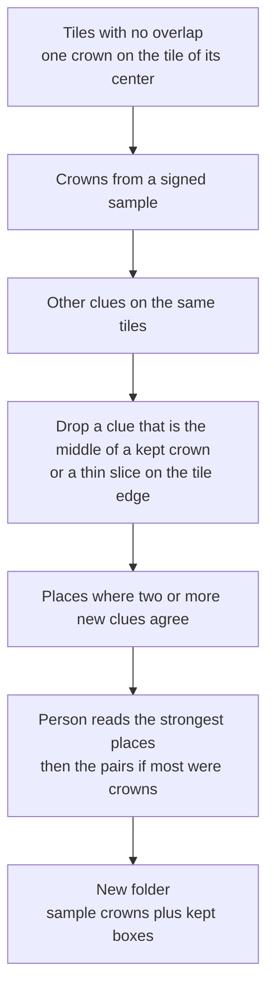

# Golden training set

**Status:** draft outline. It records how stand 17568 was closed. It does not start training. The worked example is [[experiments/normal-forest/exp-005-normal-forest-ownership-smoke]]. The stands for the next folders are named on [[experiments/normal-forest/exp-006-training-labels-backbone]]. This page does not choose them. On that experiment a crown from 2 m up to 7 m can enter as its own step after a person keeps it.

## Executive summary (for the board)

A training set here is a folder of photo tiles and one box per crown. The crown is a tree of at least 7 m, and the center of the box is inside the stand. People do not draw the whole stand. They decide the places where several independent clues agree. Crowns that a signed sample already accepted stay. Everything else stays out until a person keeps it.

This page is the procedure. The numbers from stand 17568 are an example of one run. They are not a pass bar for the next stand.

#### Takeaway

One folder, one box per crown, people only where several clues agree. No training on this page.

## What the folder contains

#### For the board

Tiles of the stand that do not overlap. One file of boxes. A note of what went in and what stayed out. A preview of every tile with the boxes drawn. The folder is not split into training and test parts, because neighboring tiles share an edge and a random split would show the same crowns on both sides.

#### Takeaway

Images, boxes, a note, and a preview. No split.

## Steps

#### For the board

Cut the stand into tiles. Keep the crowns a signed sample already accepted. Add other clues on those tiles and do not call them labels. A person reads the places where several clues agree, strongest first, and keeps one box or deletes the place. Copy the result into a new folder. Do not overwrite the sample files or the view that still shows every clue.

1. Name the stand. Confirm the photo, the wide-window boxes, the tight-window boxes, the treetops, and the height model are on disk. Tree height is the treetop's height, at least 7 m. Do not choose the stand on this page.
2. Cut tiles edge to edge, 800 px, no overlap. Fold a short leftover strip into the tile before it. Draw each crown once, on the tile that contains its center. Darken pixels outside the stand and draw the boundary. Keep the orthophoto in storage and read one window at a time.
3. Freeze the crowns a signed sample already accepted. Do not edit those files. On stand 17568 that freeze is the 8601 crowns.
4. Lay other clues on the same tiles. A clue stays when its center is inside the stand, outside the middle of every frozen crown, and no frozen center sits inside the clue. A small clue in the outer part of a frozen crown stays when its area is under one third of that crown. A thin clue glued to the tile edge is dropped. Centers within 20 px of each other collapse to one clue. Clues are not labels.
5. Group new clues whose centers lie within 30 px. A group that contains a frozen crown is not a new tree. A person reads groups of three or four clues first. One decision, one box: the vision-model box, otherwise the high height-model box, otherwise the photo box. A new treetop stays a point, not a crown. The person may resize the box, shrink it onto one crown and draw a second box, or delete the place. If most of those places are crowns, read the pairs that are not only the low height band. If about half or fewer are crowns, do not open the pairs. Pairs whose only height clue is the low band stay out. A clue with no partner stays out.
6. Write the kept boxes beside the frozen crowns. Drop a kept box whose center is within 8 px of a frozen crown. Copy the tiles and write one annotation file. Store the whole crown even when the box crosses the tile edge. Write the counts, the grid, and what stayed out. Draw one outline color on a preview of every tile, including tiles with no crown.

#### Takeaway

Six steps. The person sees the agreements, not the whole stand. The sample files stay as they were.

## What stays out

#### For the board

A clue alone. A pair whose only height evidence is too short for the 7 m rule. A box the person deleted. A box that lands on a crown already kept. The view that still shows every clue is a reference, not the training set. A score of a model, a species name, and a split into training and test parts are not part of this folder.

#### Takeaway

Agreement, then a person. Everything else stays out of the folder.

## What stand 17568 produced

#### For the board

One closed folder. These counts are that stand. They do not set the bar for the next one.

| Item | Count |
|------|------:|
| Tiles | 168 |
| Crowns from the two samples | 8601 |
| Crowns a person added | 100 |
| Crowns in the folder | 8701 |
| Strongest places read | 32, of which 2 were deleted |
| Pairs read | 86, of which 17 were deleted |
| Pairs left unread because the only height clue was the low band | 42 |

The folder is `research/exp-005/data/golden/golden-663-17568/` and `gs://conifer-vision/big-trees/summer/detection_data/golden-663-17568`. One resized pair was not copied because its center was 1.1 px from a crown already in the set.

#### Takeaway

8701 crowns on 168 tiles. The counts belong to this stand.

## What this page does not decide

#### For the board

It does not name the next stand. It does not copy these crowns onto that stand. It does not train a detector. It does not say how many crowns are enough before a model is worth training. That question stays unwritten until someone signs it.

#### Takeaway

A procedure for the next folder. No stand, no training, no usefulness bar.

## Related

- [[experiments/normal-forest/exp-005-normal-forest-ownership-smoke]] — the run this page is taken from
- [[experiments/normal-forest/exp-006-training-labels-backbone]] — a later stand, not started
- [[project/normal-forest-flow]]
- [[concepts/crown-ownership]]
- [[concepts/pseudo-label-audit-cvat]]
