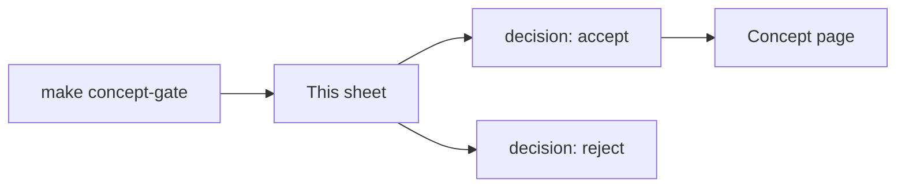

# Concept proposals

This sheet is the decision. The terminal list is only a copy.

Set `decision` to `accept` or `reject`. To correct a proposal, edit `name`, `slug`, and `why`, then set `decision` to `accept`. Leave `pending` while you are still reading.

Then run `make concept-gate APPLY=1`. That writes a concept page for each `accept`. It does not open an experiment folder.

## point-cloud-individual-tree-segmentation

decision: accepted
name: Point Cloud Individual Tree Segmentation
slug: point-cloud-individual-tree-segmentation
why: Existing concept canopy-height-model and literature-map-dense-itd focus on raster CHMs or dense 2D imagery, leaving direct 3D point cloud clustering and bottom-up tree instance segmentation unrepresented.
sources:
- sources/paper-a simple oriented search and clustering method for extracting individual forest trees from als point clouds-1-s2-0-s157495412400520x-main
- sources/paper-forestformer3d_a_unified_framework_for_end-to-end_segmentation_of_forest_lidar_3dpoint_clouds-2506-16991v1
- sources/paper-self-supervised_learning_for_precise_individual_tree_segmentation_in_airborne_lidar_point_clouds

## promptable-tree-crown-segmentation

decision: accpept
name: Promptable Tree Crown Segmentation
slug: promptable-tree-crown-segmentation
why: Existing concepts crown-ownership and literature-map-dense-itd do not cover foundation model zero-shot prompting workflows (e.g. SAM/SAM2 driven by bounding boxes or point queries) for tree crown delineation.
sources:
- sources/paper-zero-shot_tree_detection_and_segmentation_from_aerial_forest_imagery-2506-03114v1
- sources/paper-treepseco_scaling_individual_tree_crown_segmentation_using_large_vision_models-isprs-archives-xlviii-m-7-2025-275-2025
- sources/paper-fsod-vfm

## tree-allometry

decision: accepted
name: Tree-Level Allometric Scaling
slug: tree-allometry
why: Existing concept site-index-and-yield explicitly restricts coverage to stand-level site index, dominant height, basal area, and yield capacity, leaving individual tree DBH, crown width, crown base height, and stem volume relationships unrepresented.
sources:
- sources/paper-a crown width-diameter model for natural even-aged black pine forest management-forests-09-00610-v2
- sources/paper-a rapid method for estimating the median diameter of the stem profile of norway spruce trees-iforest_ifor1945-009_vasilescu
- sources/paper-a_linkage_among_tree_diameter_height_crown_base_he
- sources/paper-alder_allometry_cpi023
- sources/paper-allometric relationships of selected european tree-gp_eudor_pdfa1b_euna20855enc_001

## understory-tree-detection

decision: accepted
name: Understory tree detection
slug: understory-tree-detection
why: A canopy-height surface shows the top tree. A stem under that crown has no peak of its own. Dense-stand detection is side-by-side overlap, not this vertical case.
sources:
- sources/paper-tree_crown_segmentation_in_three_dimensions_using_density_models_derived_from_airborne_laser_scanning-holmgren_j_et_al_220114
- sources/paper-a simple oriented search and clustering method for extracting individual forest trees from als point clouds-1-s2-0-s157495412400520x-main
