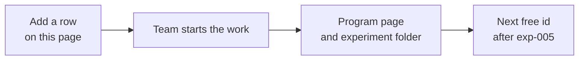

# Research domains

**Status:** draft. This page is the recipe for the next domain. It is not a new research program and it does not authorize work.

## Executive summary (for the board)

Each product line has one program page and one experiment folder. Numbers continue across the whole wiki. A new line does not start again at exp-001.

The active proposal is normal forest. The R-class detection program stays on file as history. Species classification, a map of the stand, and allometry are named here so they have a place. None of those three has a folder yet.

#### Takeaway

A new product line begins as one row. The folder appears only when the work starts, and it takes the next free experiment number.

## Domains

#### For the board

Two lines have pages today. Three names are reserved and have no experiment folder. Allometry has a shared concept page for site index and stand volume. It is not a started program. Crown outlines for one tree stay inside the normal-forest program. A map of the whole stand is a different line.

| Slug | Program page | Experiment folder | Status |
|------|----------------|-------------------|--------|
| r-class-itd | [[project/research-tree-detection-ensemble]] | [[experiments/r-class-itd/index]] | history; not the current priority |
| normal-forest | [[project/research-normal-forest]] | [[experiments/normal-forest/index]] | proposed; ADR-003 proposed; next smoke is exp-005 |
| species-classification | none yet; method already at [[methods/dinov3-classification]] | do not create yet | not started |
| stand-segmentation | none yet | do not create yet | not started. This is a map of the stand, not a crown outline |
| allometry | none yet; shared concept [[concepts/site-index-and-yield]] and [[concepts/tree-allometry]] | do not create yet | not started |

#### Takeaway

Read this table to see which line is active. An empty row is a name, not a project that has started.

## How to add a domain

#### For the board

Write the name here first. Open a program page and a folder together only when people are actually going to run something. The first experiment in that folder uses the next number in the whole wiki. After exp-005, that number is exp-006, whichever line starts next. Shared tools stay in one place. The new page points at them.

1. Add one row here. Do not create a folder in the same step.
2. When the team actually starts, add `project/research-<slug>.md` and `experiments/<slug>/index.md` together.
3. The first experiment uses the next free global id. After exp-005 the next id is exp-006, in whichever domain starts next.
4. Link the program from [[index]] only when it is the current focus or a listed program. Current focus names one active program.
5. Shared methods and concepts stay in `methods/` and `concepts/`. A domain page links to them. It does not copy them.

#### Takeaway

One row, then a page and a folder together, then the next free number. Do not copy a shared method into the new folder.

## Related

- [[project/research-normal-forest]]
- [[project/research-tree-detection-ensemble]]
- [[project/decisions]]
- [[project/hypothesis-validation-loop]]
- [[experiments/index]]
- [[methods/dinov3-classification]]
