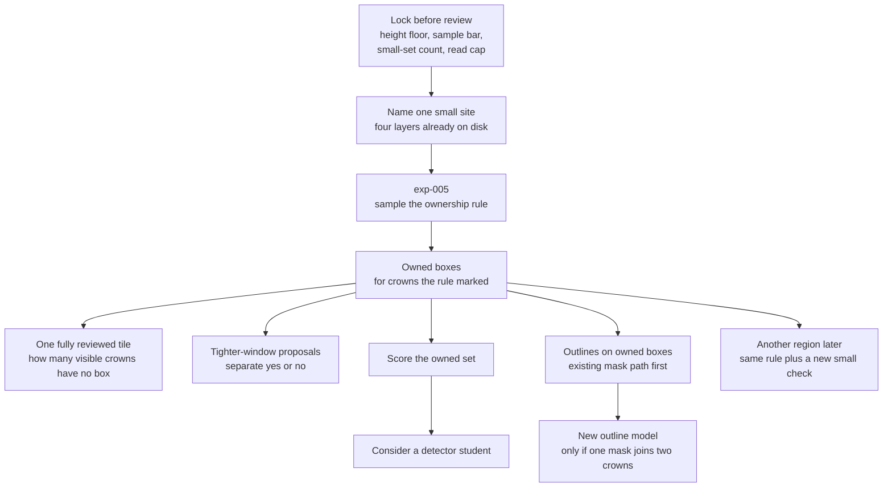
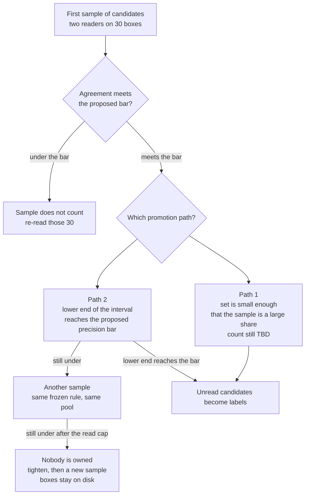
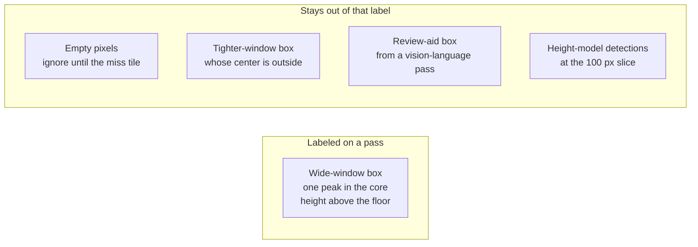

# Normal-forest task flow

**Status:** draft discussion sheet. It condenses [[project/research-normal-forest]]. It does not accept ADR-003, it does not sign the sample bar, and it does not number any experiment after exp-005.

## Executive summary (for the board)

The task is one trusted box per crown on trees larger than R-class, where a treetop can be told apart, and then an outline of that crown. The photo model that draws boxes already exists. This flow checks those boxes before anyone trains a new detector or a new outline model.

exp-005 is the first human sample of that check. A pass labels the crowns the rule already marked. A detector student is a later step, after that labeled set is scored. Outlines start on those same boxes, with the mask path we already have. A new outline model starts only if one mask joins two crowns that touch.

#### Takeaway

Training is the product aim. The sample, the labels, and a score of those labels come first.

## What the task is

#### For the board

Larger trees with separable tops. A stand where tops clump together is outside the task. The test site is still unnamed. It is not a site we already used for small trees. People review a sample. They do not draw the stand by hand.

The cohort is [[concepts/normal-forest]]. The labeling rule is [[concepts/crown-ownership]]. The program page is [[project/research-normal-forest]]. The first experiment is [[experiments/normal-forest/exp-005-normal-forest-ownership-smoke]].

#### Takeaway

One unnamed site, one frozen rule, one sample. Small-tree sites do not score this task.

## Whole path

#### For the board

Read the picture from top to bottom. Each box is a gate. Naming the site does not train a model. The sample does not draw outlines. The student waits on a score of the labeled boxes.

Phases, in the same order. Later phases have no experiment number until the team writes one. The next global id, when that happens, is exp-006. This page does not create it.

| Phase | What happens | Output |
|-------|----------------|--------|
| 0 | Name the site. Confirm four layers: photo model at window 800, photo model at window 400, local maxima, height model. | A named site. No training. |
| 1 | exp-005. Candidates are window-800 boxes with one peak in the core and height above the floor. People read a sample. | A pass or a fail of that frozen rule. |
| 2 | On a pass, those boxes are labels for the crowns they mark. Empty pixels stay ignore. One fully reviewed tile counts visible crowns that have no box. | Owned boxes, plus a miss count on one tile. |
| 3 | Window-400 boxes whose center lies outside every owned box. Separate yes/no sample. | A proposal list. Not labels yet. |
| 4 | Score the owned set. Only after that score, consider a detector student. | A score, then a decision to train or not. |
| 5 | Outlines on owned boxes only. Existing mask path first (SAM vit_h from [[experiments/r-class-itd/exp-002-rgb-seg-backend-ceiling]]). A new outline model starts only if a mask joins two crowns that touch. ECSeg and StarDist stay deferred. | Crown outlines, or a reason to train a new one. |
| 6 | Another region reuses the frozen rule plus its own small human check. That check is not copied into this site’s labels. | A later region, still checked by people. |

#### Takeaway

exp-005 ends at phase 1. Labels, the miss tile, proposals, the score, the student, and outlines are later gates.

## How the sample promotes labels

#### For the board

People read candidates, up to 20 tiles and 150 boxes. A second person reads 30 of them. Two ways exist to turn the unread candidates into labels. Both are still to lock before the review task opens. A raw pass on the first 150 boxes does not by itself label the rest.

Agreement is separate. Under the proposed 80 percent, the sample does not count: re-read those 30 boxes. Do not add boxes to water down a disagreement. A wide interval is not an agreement failure.

One frozen rule covers the whole candidate set. Do not split the pool into batches that each become labels or each get their own rule.

Path 2, in words: the gate is the lower end of a 95% Wilson interval, compared with the proposed precision bar of 0.95. If that lower end is still under the bar, draw another sample from the same rule. Tightening starts only after a read cap, written before review, and the lower end is still under the bar. The cap number is TBD. About 450 reads is the arithmetic for a ±2 point interval around 0.95. It is not the cap and it is not a pass mark.

The 10,000-box case is an illustration that 150 boxes are a small share. It is not a threshold.

On a fail after the read cap, nobody is owned. Tighten the rule (peak closer to the center, or a higher height floor), then draw a new sample. Do not re-label the same boxes until the fraction looks better. The boxes stay on disk. A kill does not authorize training.

Detail lives on [[concepts/crown-ownership]] and on [[experiments/normal-forest/exp-005-normal-forest-ownership-smoke]].

#### Takeaway

Unread boxes become labels on a small set, or when the lower end of the interval reaches the proposed bar. Otherwise they stay candidates.

## What a pass labels

#### For the board

A pass labels crowns the wide-window rule already marked. It does not label every tree in the picture, and it does not label the tighter-window leftovers.

A review-aid box does not create a label. A missing review-aid box does not delete a detector box. Height-model detections at slice 100 px are not a witness.

#### Takeaway

The label is the wide-window crown the rule marked. Everything else waits for its own step.

## When a model is trained

#### For the board

The photo model that proposes boxes is already trained and already run. This flow does not retrain it inside exp-005. A new detector is considered only after phase 4 scores the owned set. The wiki says consider, not start. No usefulness bar for that score is written yet.

Outlines use the existing mask path on owned boxes. A new outline model is a separate decision, and only after a mask joins two crowns that touch.

The small-tree student in [[experiments/r-class-itd/exp-004-rgb-small-student-pseudo-v2]] stays closed. This flow does not reopen it.

#### Takeaway

New training starts after a scored set of owned boxes. exp-005 does not train.

## Still open before this flow is confirmed

#### For the board

These items are blank on purpose. Confirming the picture does not fill them. The review task stays closed until the team writes the blanks.

| Item | State |
|------|--------|
| ADR-003 | Proposed, not accepted |
| exp-005 | Draft, not started |
| Test site id | TBD |
| Height floor | TBD, write before review |
| Precision bar 0.95 and agreement 0.80 | Proposed, not signed |
| Count that counts as a small set | TBD, write before review |
| Read cap on path 2 | TBD, write before review |
| Detector-student usefulness bar | Not written. Phase 4 only says consider a student after the score |
| Experiments after exp-005 | Not created |

`kaxen_197_1`, AREA 540, and AREA 481 do not score this task. The AREA 540 audit procedure on [[concepts/pseudo-label-audit-cvat]] stays as it is. Verdicts and the 20×150 cap are reused. That page’s training rule is not this flow.

#### Takeaway

The shape of the path can be confirmed now. The blanks stay blank until the team locks them.

## Related

- [[project/research-normal-forest]]
- [[project/decisions]] — ADR-003 (proposed)
- [[project/domains]]
- [[concepts/normal-forest]]
- [[concepts/crown-ownership]]
- [[concepts/pseudo-label-audit-cvat]]
- [[experiments/normal-forest/exp-005-normal-forest-ownership-smoke]]
- [[experiments/r-class-itd/exp-002-rgb-seg-backend-ceiling]]
- [[experiments/r-class-itd/exp-004-rgb-small-student-pseudo-v2]]
