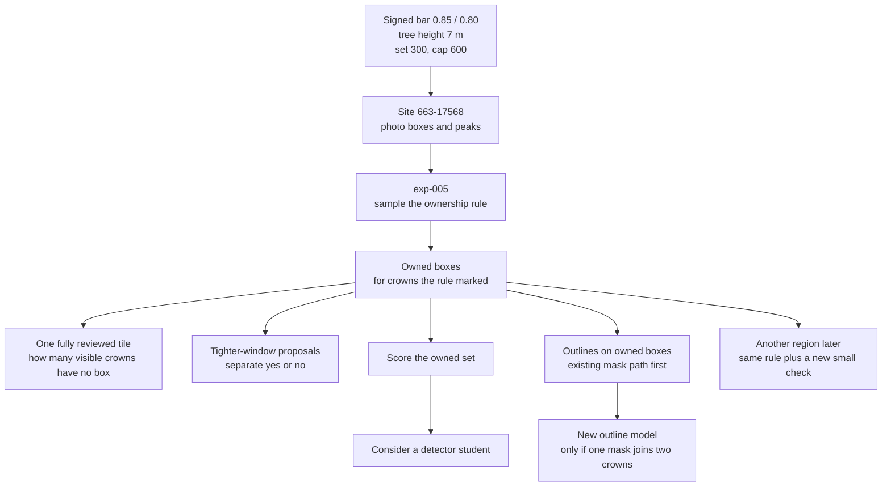
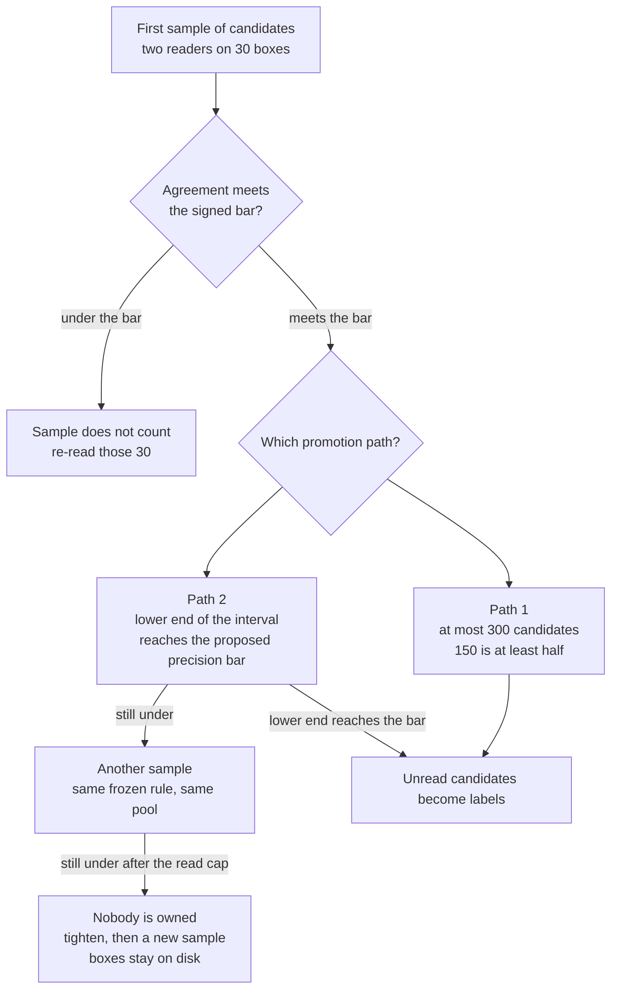
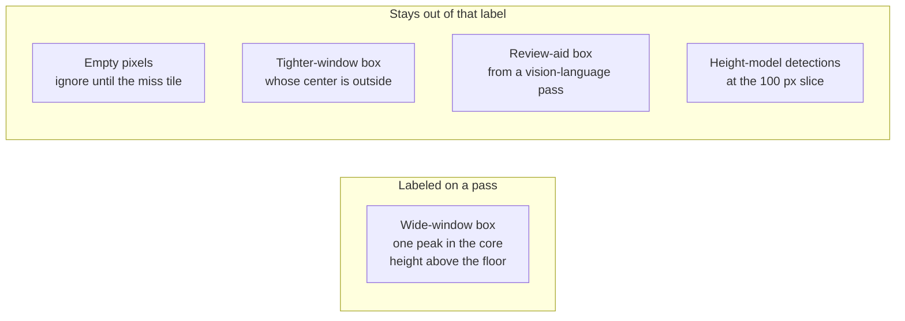
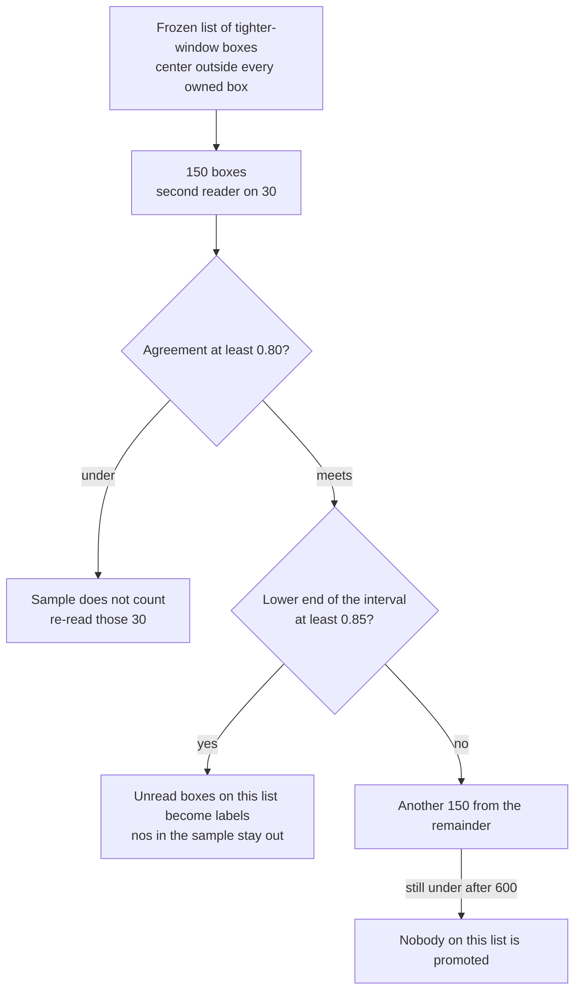

# Normal-forest task flow

**Status:** draft discussion sheet. It condenses [[project/research-normal-forest]]. It does not accept ADR-003. exp-005 is closed. Its product is the golden folder for stand 17568. The procedure for a later folder is [[methods/golden-training-set]]. [[experiments/normal-forest/exp-006-training-labels-backbone]] is opened. The stands are named there. Labeling has not started. The phase 4 score and a student are not started.

## Executive summary (for the board)

The task is one trusted box per crown on trees larger than R-class, where a treetop can be told apart, and then an outline of that crown. The photo model that draws boxes already exists. This flow checks those boxes before anyone trains a new detector or a new outline model.

exp-005 is the first human sample of that check. A pass labels the crowns the rule already marked. A detector student is a later step, after that labeled set is scored. Outlines start on those same boxes, with the mask path we already have. A new outline model starts only if one mask joins two crowns that touch.

#### Takeaway

Training is the product aim. The sample, the labels, and a score of those labels come first.

## What the task is

#### For the board

Larger trees with separable tops. A stand where tops clump together is outside the task. The test site is AREA 663-17568. Tree height is at least 7 m, from the local-maxima peak Z. It is not a site we already used for small trees. People review a sample. They do not draw the stand by hand.

The cohort is [[concepts/normal-forest]]. The labeling rule is [[concepts/crown-ownership]]. The program page is [[project/research-normal-forest]]. The first experiment is [[experiments/normal-forest/exp-005-normal-forest-ownership-smoke]].

#### Takeaway

AREA 663-17568, one frozen rule, one sample. Small-tree sites do not score this task.

## Whole path

#### For the board

Read the picture from top to bottom. Each box is a gate. Naming the site does not train a model. The sample does not draw outlines. The student waits on a score of the labeled boxes.

Phases, in the same order. On 2026-11-10 phase 6 is [[experiments/normal-forest/exp-006-training-labels-backbone]]. No area is named. The next free id after that is exp-007.

| Phase | What happens | Output |
|-------|----------------|--------|
| 0 | Name the site. Confirm four layers: photo model at window 800, photo model at window 400, local maxima, height model. | A named site. No training. |
| 1 | exp-005. Candidates are window-800 boxes with one peak in the core and height above the floor. People read a sample. | A pass or a fail of that frozen rule. |
| 2 | On a pass, those boxes are labels for the crowns they mark. One fully reviewed tile counts visible crowns that have no box. | Owned boxes. On `tile_03`, five crowns have no owned box. They are not added as labels. |
| 3 | Window-400 boxes whose center lies outside every owned box. Separate sample, with its own promotion lock. | Read 2026-11-04. Precision 0.967, agreement 0.867. 2719 labels. Five wrong-size boxes stay out. |
| 4 | Score the owned set. Only after that score, consider a detector student. | A score, then a decision to train or not. |
| 5 | A copy of the labels first. A box that sits inside another box does not stay. One crown keeps the larger box. A pair a person marked as two crowns drops the larger box and gains a new box for the other crown. Outlines then use that copy. Existing mask path first (SAM vit_h from [[experiments/r-class-itd/exp-002-rgb-seg-backend-ceiling]]). A new outline model starts only if a mask joins two crowns that touch. ECSeg and StarDist stay deferred. | One box per crown, then crown outlines, or a reason to train a new outline model. |
| 6 | Another region reuses the frozen rule plus its own small human check. That check is not copied into this site’s labels. | A later region, still checked by people. |

#### Takeaway

exp-005 is closed. The golden folder for stand 17568 is the label product. The phase 4 score and a student are not started. exp-006 names the later stands and has not started labeling. The steps for that later folder are [[methods/golden-training-set]].

## How the sample promotes labels

#### For the board

People read candidates, up to 20 tiles and 150 boxes. A second person reads 30 of them. Two ways exist to turn the unread candidates into labels. A small set is at most 300 candidates. The wider sample stops after 600 candidate boxes. The precision bar is signed at 0.85. A raw pass on the first 150 boxes does not by itself label the rest.

Agreement is separate. Under the proposed 80 percent, the sample does not count: re-read those 30 boxes. Do not add boxes to water down a disagreement. A wide interval is not an agreement failure.

One frozen rule covers the whole candidate set. Do not split the pool into batches that each become labels or each get their own rule.

Path 2, in words: the gate is the lower end of a 95% Wilson interval, compared with the signed precision bar of 0.85. If that lower end is still under the bar, draw another sample from the same rule. Tightening starts only after 600 candidate boxes, and the lower end is still under the bar. About 1200 reads is the arithmetic for a ±2 point interval around 0.85. It is not the cap and it is not a pass mark.

The 10,000-box case is an illustration that 150 boxes are a small share. It is not a threshold.

On a fail after 600 candidate boxes, nobody is owned. Tighten the rule (peak closer to the center, or a higher tree height), then draw a new sample. Do not re-label the same boxes until the fraction looks better. The boxes stay on disk. A kill does not authorize training.

Detail lives on [[concepts/crown-ownership]] and on [[experiments/normal-forest/exp-005-normal-forest-ownership-smoke]].

#### Takeaway

Unread boxes become labels on a small set, or when the lower end of the interval reaches the signed bar. Otherwise they stay candidates.

## What a pass labels

#### For the board

A pass labels crowns the wide-window rule already marked. It does not label every tree in the picture, and it does not label the tighter-window leftovers.

A review-aid box does not create a label. A missing review-aid box does not delete a detector box. Height-model detections at slice 100 px are not a witness.

#### Takeaway

The label is the wide-window crown the rule marked. Everything else waits for its own step.

## How a proposal becomes a label

#### For the board

A tighter-window box does not become a label because the wide-window sample passed. It has its own list and its own reading. Yes means a visible crown the owned box did not cover. No means empty ground, a shadow, or a piece of a crown that already has a box. People read 150 boxes. A second person reads 30 of them. Under 80 percent agreement, that sample does not count, and those 30 are read again. The small-set path does not apply. Unread boxes on this list become labels only when the lower end of the interval reaches 0.85. If it does not, draw another 150 from what is left, and stop at 600. After 600, nobody on this list is promoted. A no in the sample stays out. Do not re-read the same boxes to raise the fraction.

On stand 17568 the list is 2724 boxes from the photo model at window 400. The center sits inside the stand and outside every owned box. Precision is yes divided by yes plus no. An unset box means the sample is unfinished. The gate is the lower end of a 95% Wilson interval, z = 1.96, against 0.85. On 150 boxes that lower end reaches 0.85 at 137 yes. At 600 boxes it reaches 0.85 at 528 yes. The 30 second reads count toward agreement, not toward the 600. This lock does not reopen the window-800 labels.

The sample was read on 2026-11-04. Twenty windows, 150 boxes, 30 for the second reader. One hundred forty boxes come from the ten windows with the most proposals. Ten come from the ten windows with the fewest. The task used the same three verdicts as the wide-window sample: `accept`, `reject`, `accept_resize`. Precision is `accept` divided by every judged box. Primary read: 145 accept, 5 `accept_resize`, 0 reject, unset 0. Precision 145/150 = 0.967. Wilson lower end 0.924, upper end 0.986, z = 1.96. Agreement 26/30 = 0.867. The small-set path does not apply. The lower end clears 0.85, so unread boxes on this list become labels. The five `accept_resize` boxes stay out (annotation ids 30, 55, 70, 137, 144; proposal indexes 505, 2465, 2366, 1786, 859). That leaves 2719 labels. The two second-reader rejects do not remove a box the primary reader accepted.

Four boxes differ:

| Annotation id | Window | Primary | Second reader |
|---|---|---|---|
| 30 | tile_10640_7840 | accept_resize | accept |
| 128 | tile_9520_6720 | accept | reject |
| 144 | tile_3360_7840 | accept_resize | accept |
| 146 | tile_2800_8960 | accept | reject |

Annotation 144 is one of the five that stay out. Annotation 146 is not: the primary verdict is accept. The promoted list still holds 113 pairs in which the smaller box lies mostly inside a larger one. Their IoU is under the detection threshold of 0.5, so this gate did not remove them. exp-005 does not own this reading. No training.

On 2026-11-06 the outline copy uses a wider test: 75% of the smaller box's area inside the larger one, same set only. That finds 27 pairs in the 800 px labels and 135 in the 400 px labels. A pair left commented is one crown: the smaller box drops, the larger stays. Eight pairs a person marked as two crowns go the other way: the larger box drops, the smaller stays, and the other crown is still missing its box. That box comes from a mask prompted only on the part of the large box outside the small one. After the drops, no box in the copy sits inside another. The copy has 8601 boxes until those eight return. The 6043 and 2719 files are not edited. A five-window outline run from the same day is withdrawn. Its prompts still included a large box around two crowns, and the masks were deleted.

#### Takeaway

The proposal sample passes. Unread boxes on the list of 2724 become labels, except the five wrong-size boxes.

## When a model is trained

#### For the board

The photo model that proposes boxes is already trained and already run. This flow does not retrain it inside exp-005. A new detector is considered only after phase 4 scores the owned set. The wiki says consider, not start. No usefulness bar for that score is written yet.

Outlines use the existing mask path on the outline copy, not on a box that still contains another box. A new outline model is a separate decision, and only after a mask joins two crowns that touch. On the exp-005 copy, the eight second crowns are a person's first correction round. The dark seam on those pairs is not a box.

The small-tree student in [[experiments/r-class-itd/exp-004-rgb-small-student-pseudo-v2]] stays closed. This flow does not reopen it.

#### Takeaway

New training starts after a scored set of owned boxes. exp-005 does not train.

## Still open before this flow is confirmed

#### For the board

The precision bar is signed. The rows below record the locks and the blanks that remain.

| Item | State |
|------|--------|
| ADR-003 | Proposed, not accepted |
| exp-005 | Closed 2026-11-19. Sample 2026-11-02 stands: precision 0.973, agreement 0.80. Product is the golden folder, 8701 crowns. No training |
| Test site id | 663-17568 |
| Tree height | At least 7 m, from the local-maxima peak Z |
| Precision bar 0.85 and agreement 0.80 | Signed |
| Count that counts as a small set | 300 candidates |
| Read cap on path 2 | 600 candidate boxes |
| Proposal sample | Read 2026-11-04. Precision 0.967 (145/150, Wilson lower end 0.924), agreement 0.867 (26/30). 2719 labels. Five `accept_resize` stay out |
| Detector-student usefulness bar | Not written. Phase 4 only says consider a student after the score |
| Outline copy | 2026-11-19. The golden folder is the closed label set. The 8601 copy is not overwritten. Eight boxes from an earlier mask cut stay out. A dark seam is not a label |
| exp-006 | Opened 2026-11-10. No area named. Backbone only. Outliers wait until that area has its own sample |

`kaxen_197_1`, AREA 540, and AREA 481 do not score this task. The AREA 540 audit procedure on [[concepts/pseudo-label-audit-cvat]] stays as it is. Verdicts and the 20×150 cap are reused. That page’s training rule is not this flow.

#### Takeaway

The shape of the path can be confirmed now. The blanks stay blank until the team locks them.

## Related

- [[project/research-normal-forest]]
- [[project/decisions]] — ADR-003 (proposed)
- [[project/domains]]
- [[concepts/normal-forest]]
- [[concepts/crown-ownership]]
- [[concepts/pseudo-label-audit-cvat]]
- [[experiments/normal-forest/exp-005-normal-forest-ownership-smoke]]
- [[methods/golden-training-set]]
- [[experiments/r-class-itd/exp-002-rgb-seg-backend-ceiling]]
- [[experiments/r-class-itd/exp-004-rgb-small-student-pseudo-v2]]
