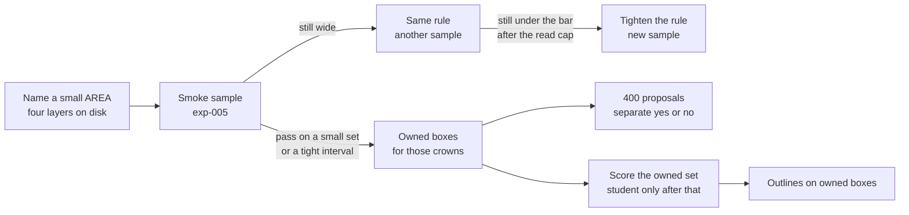

# Normal-forest crown detection and segmentation

**Status:** draft. **ADR-003** in [[project/decisions]] is **proposed**, not accepted. The exp-005 bar is signed: precision ≥ 0.85 and agreement ≥ 0.80. The test AREA is 663-17568. Tree height is at least 7 m. exp-005 is closed. Its product is the golden folder for stand 17568. A condensed discussion sheet is [[project/normal-forest-flow]]. The draft procedure for a later folder is [[methods/golden-training-set]]. It does not add a phase.

## Executive summary (for the board)

The product bet is one box per crown on trees larger than R-class, in forest where a local-maxima peak can be assigned to one crown. The exp-005 test AREA is 663-17568. People spot-check the ownership rule. They do not draw the stand. Segmentation waits until those boxes are trusted.

`kaxen_197_1` and AREA 540 do not score this program. The previous north star, [[project/research-tree-detection-ensemble]], stays in the wiki as history.

#### Takeaway

One trusted box per separable crown comes first. Outlines, and any later student, wait on that check.

## Cohort

#### For the board

This task is larger trees with tops we can tell apart. A stand where the tops clump together is outside the task, including when someone calls that stand normal forest. Tree height is at least 7 m, from the local-maxima peak Z.

In operational terms:

- Larger than R-class. Tree height at least 7 m.
- A peak maps to one crown. A stand where peaks merge into clumps is outside this task even if sales calls it normal forest.
- Not `kaxen_197_1`. Not AREA 540. Not the pre-thinning thicket in [[concepts/dense-stand-detection]].

See [[concepts/normal-forest]] and [[concepts/crown-ownership]].

#### Takeaway

The cohort is separable crowns above R-class. The test AREA is not chosen yet, and it is not a site we already used for small trees.

## Phases

#### For the board

Each phase has a gate. Naming the site does not train a model. The first human check is a sample of crown candidates. Only a passing sample turns those candidates into labels for the crowns they mark. A tighter-window box outside those crowns is a separate question. A student is not part of the first experiment. Outlines start only after the boxes are trusted.

0. Name the small AREA. Confirm SAHI 800 and local maxima. Tree height is the peak Z. Do not train. CHM detections are out of this smoke. SAHI 400 is the later proposal list.
1. Smoke: build ownership candidates (SAHI 800, one peak in the core, tree height above 7 m). Sample them. This is [[experiments/normal-forest/exp-005-normal-forest-ownership-smoke]].
2. If the sample passes, those labels are ground truth for the crowns they mark. Unread candidates are promoted only by the small-set path or the Wilson lower-bound path. The small-set count is 300. The read cap is 600. The bar is signed at 0.85 and 0.80. On `tile_03`, five visible crowns have neither an owned 800 px box nor an owned 400 px box. They are not added as labels. Gaps that are not those five crowns can be background on that window.
3. Proposals are SAHI 400 boxes whose center lies outside every owned box. On stand 17568 that list is 2724 boxes. They do not inherit owned status from the window-800 pass. The sample was read on 2026-11-04: precision 0.967 (145/150, Wilson lower end 0.924) and agreement 0.867 (26/30). The lower end clears 0.85, so unread boxes on this list become labels. Five `accept_resize` boxes stay out, leaving 2719. The lock and the disagreements are on [[project/normal-forest-flow]].
4. Only after phase 2, score the owned set. Only after that score, consider a student. The student is not part of exp-005.
5. Masks on the outline copy only. A box inside another box is removed from that copy first. One crown keeps the larger box. Eight pairs marked as two crowns drop the larger box and still need a new box for the other crown. Slice outlines wait on those eight. Start a new delineation model only if a mask joins two crowns that touch. SAM vit_h from [[experiments/r-class-itd/exp-002-rgb-seg-backend-ceiling]] is the existing mask path. ECSeg and StarDist stay deferred. The five-window mask run of 2026-11-06 is withdrawn.
6. Weak labels for another region reuse the frozen rule plus a new small human check. They are not written into this AREA’s golden set. Round 2 showed that more area with an unchanged teacher does not transfer. On 2026-11-10 that later region is [[experiments/normal-forest/exp-006-training-labels-backbone]]. No area is named yet. Hard cases wait until its own sample exists.

#### Takeaway

exp-005 is closed as the reference for stand 17568. It does not train. The next labels are the stands named on [[experiments/normal-forest/exp-006-training-labels-backbone]]. The first step is still the 7 m rule. A later step adds crowns from 2 m up to 7 m after a person keeps them.

## Motivation

#### For the board

R-class small-tree finding stopped being the commercial priority. [[experiments/r-class-itd/exp-004-rgb-small-student-pseudo-v2]] closed without training. The useful piece of that pilot is the procedure: a wide-window box is usually one crown, and a tighter box is a proposal only when its center sits outside that crown. [[experiments/r-class-itd/exp-003-merge-fusion-v1]] stays parked because the cohort changed. This page does not fuse layers. An 800 box becomes a candidate when one peak sits in its core and the height is above the floor ([[concepts/crown-ownership]]).

### Illustration, not a milestone, not a gate

One 800×800 tile, file `01_y0_x0.jpg`, cut from `research/exp-004/image (1).png`. Not AREA 540. Not golden. `svk_full` SAHI 800 found 100 crowns. A Gemini 4 hole-fill pass listed 230. SAHI 400 found 317, of which 194 have their center outside every 800 box. Of the Gemini boxes whose centers fall outside the 800 map, 120 contain a 400-proposal center and 12 do not. Forty of the 194 proposals lie in no Gemini box. Forty-five of the 317 slice-400 boxes have their center outside every Gemini box.

Read this as: the 800 map is the crown layer, 400 is the proposal layer, and the VLM is a review aid. These counts are not success thresholds. A VLM box is not a label. A missing VLM box does not delete a detector box.

#### Takeaway

The tile shows how to read the three layers. It does not pass a gate and it does not name the test AREA.

## Related

- [[project/normal-forest-flow]] — condensed path for discussion; does not add a phase
- [[project/decisions]] — ADR-003 (proposed)
- [[project/research-tree-detection-ensemble]] — previous north star; background as of 2026-10-21
- [[concepts/normal-forest]]
- [[concepts/crown-ownership]]
- [[concepts/dense-stand-detection]]
- [[concepts/pseudo-label-audit-cvat]]
- [[concepts/canopy-height-model]]
- [[experiments/normal-forest/exp-005-normal-forest-ownership-smoke]]
- [[experiments/r-class-itd/exp-004-rgb-small-student-pseudo-v2]]
- [[experiments/r-class-itd/exp-003-merge-fusion-v1]]
- [[experiments/r-class-itd/exp-002-rgb-seg-backend-ceiling]]
- [[methods/deimv2-canopy]]
- [[methods/local-maxima]]
- [[methods/chm-detection]]
